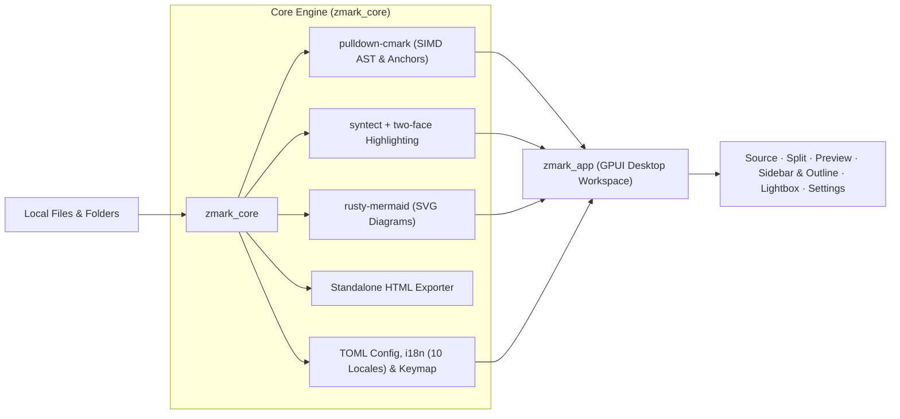

<div align="center">


# ZMark

**Fast, native local-first Markdown editor, reader, and Mermaid diagram workspace built with Rust & GPUI.**

[](https://github.com/2716190547/zmark-releases/releases)
[](https://github.com/2716190547/zmark/actions/workflows/build-desktop.yml)
[](rust-toolchain.toml)
[](https://crates.io/crates/gpui)
[](#download-and-install)
[](#highlights)

[English](README.md) · [简体中文](README.zh-CN.md) · [Download Installers](https://github.com/2716190547/zmark-releases/releases/tag/v0.2.12) · [Gitee Mirror](https://gitee.com/zeng_sc/zmark-releases/releases) · [GitHub Repo](https://github.com/2716190547/zmark)

</div>

---

## Why ZMark?

**ZMark** is an offline-first desktop Markdown and source-text workspace engineered for speed, typography clarity, and visual architecture notes—without Electron memory overhead or cloud lock-in.

- **GPU-Native Desktop UI**: Built on Rust and **GPUI**, keeping startup instant and scrolling crisp across long technical specs, code listings, and nested diagrams.
- **Block-Aligned Split Editing**: Edit Markdown in **Source**, **Split**, or **Preview** modes with smooth synchronized scrolling between your editor cursor/viewport and rendered blocks.
- **Built-in Mermaid & HiDPI Lightbox**: Render `flowchart` / Mermaid diagrams locally to crisp SVGs and click any diagram or local image to inspect it in a zoomable lightbox.
- **Your Folders, Your Rules**: Manage multiple local folder roots, external files, and unsaved drafts side by side—all files stay directly on your disk.

---

## Highlights

| Area | Capabilities |
| --- | --- |
| **Writing & Sync Scroll** | Instant switching between **Source**, **Split**, and **Preview** modes; block-aligned smooth synchronized scrolling; drag & drop `.md` files, folders, and local images directly into the window; auto-save on idle or window blur for files with a saved path; drafts choose a destination on their first manual save. |
| **Markdown & Code Engine** | GitHub-style adaptive tables, clickable inline `[toc]` outline cards, `<br>` / `<br/>` line breaks, interactive task lists (`- [ ]` / `- [x]`), nested lists, blockquotes, horizontal rules, multi-language fenced code syntax highlighting with one-click copy, and source mode editing for Rust, Python, TypeScript/JS, C/C++, Java, Go, JSON, YAML, TOML, HTML/CSS, shell scripts, and plain text. |
| **Mermaid & Local Media** | Native local `rusty-mermaid` SVG rendering with UTF-8/CJK label support; local PNG/JPEG/GIF/WebP/SVG previews (relative to document, absolute path, or built-in `zmark-asset://` vector illustrations); click any diagram or image to zoom and pan in the HiDPI Lightbox. |
| **Workspace & Navigation** | Multi-root folder tree, loose external files, and scratch drafts; fast filename filtering (`Files`) and one-click toggle to document heading tree (`Outline`); Shift / Cmd / Ctrl multi-select, batch hide with 5-second undo, Move to Trash, inline double-click rename, and in-document highlighted Find (`Cmd+F` / `Ctrl+F`). |
| **Themes & Typography** | Light, Dark, and System appearance modes; **7 curated palettes** (*Claude Warm*, *macOS Native*, *Tokyo Night*, *Nord*, *GitHub Light*, *Solarized*, *One Dark*) plus a **Custom Theme Editor** with separate light/dark color pickers for UI and syntax tokens; customizable font family, size, column width, line height, Tab size, line numbers, and Reduced Motion. |
| **Rebindable Shortcuts & Welcome** | **17 customizable shortcuts** with live keystroke recording, `Backspace` unbinding, and conflict detection/replacement in **Settings → Shortcuts**; clean named welcome showcase document (`Welcome to ZMark.md`) enriched with interactive `[toc]` navigation and vector SVG illustrations. |
| **i18n & Export** | **10 UI languages** (`Auto`, English, 简体中文, 繁體中文, 日本語, 한국어, Français, Deutsch, Español, Русский, Português) and standalone HTML export (`Cmd+Shift+E` / `Ctrl+Shift+E`). |

---

## Architecture & Tech Stack



| Layer | Technology | Role in ZMark |
| --- | --- | --- |
| **Language & Toolchain** | **Rust `1.100.0`** | Memory-safe native binaries across macOS, Windows, and Linux (`rust-toolchain.toml`). |
| **Desktop UI Framework** | **GPUI** (`gpui-pre =0.3.12`, `gpui-component =0.9.1`) | GPU-accelerated native windowing, text layout, action keymaps, color pickers, and custom themes. |
| **Markdown AST & Anchors** | **`pulldown-cmark 0.13`** (SIMD) | Fast CommonMark/GFM parsing mapped to source line anchors for split scroll synchronization. |
| **Code Syntax Highlighting** | **`syntect 5.3`** + **`two-face 0.5.2`** | Broad multi-language syntax grammar support (`onig` on macOS, `fancy-regex` on Windows/Linux). |
| **Diagram Rendering** | **`rusty-mermaid 0.2.0`** + **`usvg 0.45.1`** | Pure-local Mermaid flowchart-to-SVG compilation (with vendored UTF-8 fix) and crisp HiDPI rasterization. |
| **Image Decoding** | **`image 0.25.10`** + macOS ImageIO | Local PNG, JPEG, GIF, and WebP previews with bounded texture budgets and fast cleanup. |
| **Config & Serialization** | **`serde`**, **`toml 0.8`**, **`serde_json`**, **`ring`** | Persistent `config.toml` preferences, sparse custom shortcuts, and signed release update checks. |

### Repository Layout

```text
ZMark/
├── crates/
│   ├── zmark_core/        # Markdown AST & source anchors, HTML export, Mermaid, syntect, i18n, config
│   ├── zmark_app/         # GPUI desktop workspace, split editor/preview, sidebar drawer, lightbox, settings
│   └── release_tool/      # Release packaging & signed update feed utilities
├── vendor/
│   └── rusty-mermaid-diagrams/  # Vendored UTF-8/CJK char-slicing fix for Mermaid parsing
├── packaging/             # macOS, Windows Inno Setup, and Linux desktop metadata
├── scripts/               # Local bundling (bundle_macos.sh), gate checks (full_gate.sh), release scripts
└── docs/                  # Release notes, ADRs, and maintenance guides
```

---

## Download and Install

**Current release: `v0.2.12`** · [Release Notes](docs/releases/v0.2.12.md)

Download installers directly from [GitHub Releases](https://github.com/2716190547/zmark-releases/releases/tag/v0.2.12). Users in mainland China can also download the macOS ZIP, Windows installer, and update feeds via the [Gitee Mirror](https://gitee.com/zeng_sc/zmark-releases/releases) (DMG and Linux packages are hosted on GitHub).

| Platform | Architecture | Package | Install Instructions |
| --- | --- | --- | --- |
| **macOS** | Apple Silicon (`arm64`) | `.zip` / `.dmg` | Extract or mount and drag `ZMark.app` into `/Applications`. |
| **Windows** | `x86_64` | Setup `.exe` | Run the installer wizard. |
| **Linux** | `x86_64` | `.deb` / `.tar.gz` | Install via `apt` / `dpkg`, or extract the archive and run `usr/bin/zmark_app`. |

> [!NOTE]
> The macOS bundle is Ad-Hoc signed (not Apple-notarized), and the Windows installer has no publisher code signature. Native local image previews do not fetch remote HTTP/HTTPS URLs; reference images locally relative to your Markdown file or via an absolute disk path (plus built-in `zmark-asset://` welcome SVGs). Exported HTML embeds typography CSS, interactive `[toc]` anchor navigation, and `<br>` line breaks, while keeping image paths as references and Mermaid blocks as fenced code.

---

## Default Keyboard Shortcuts

Every shortcut below can be inspected and rebound interactively in **Settings → Shortcuts** (click any key pill to record, `Backspace` to clear, `Esc` to cancel):

| Action | macOS | Windows / Linux |
| --- | --- | --- |
| Open file | `Cmd+O` | `Ctrl+O` |
| New draft | `Cmd+N` | `Ctrl+N` |
| Save document | `Cmd+S` | `Ctrl+S` |
| Close active document | `Cmd+W` | `Ctrl+W` |
| Export standalone HTML | `Cmd+Shift+E` | `Ctrl+Shift+E` |
| Source / Split / Preview view | `Cmd+1` / `Cmd+2` / `Cmd+3` | `Ctrl+1` / `Ctrl+2` / `Ctrl+3` |
| Toggle sidebar drawer | `Cmd+Shift+B` | `Ctrl+Shift+B` |
| Switch Files ↔ Outline tab | `Cmd+Shift+O` | `Ctrl+Shift+O` |
| Undo sidebar removal (within 5s) | `Cmd+Option+Z` | `Ctrl+Alt+Z` |
| Open Settings | `Cmd+,` | `Ctrl+,` |
| Find in document | `Cmd+F` | `Ctrl+F` |
| Next / Previous match | `Cmd+G` / `Cmd+Shift+G` (or `F3` / `Shift+F3`) | `Ctrl+G` / `Ctrl+Shift+G` (or `F3` / `Shift+F3`) |
| Bold (Markdown) | `Cmd+B` | `Ctrl+B` |
| Numbered list (Markdown) | `Cmd+Shift+7` | `Ctrl+Shift+7` |
| Exit multiselect / close Find / close Modal | `Esc` | `Esc` |

---

## Build from Source

Active development lives on the `dev` branch and syncs to `master`. `rust-toolchain.toml` pins **Rust `1.100.0`** so Cargo selects the exact toolchain automatically under `rustup`.

```sh
git clone https://github.com/2716190547/zmark.git
cd zmark
cargo run -p zmark_app
```

Platform build dependencies (such as Ubuntu `wayland` / `x11` / `fontconfig` libraries) are documented in [`.github/workflows/build-desktop.yml`](.github/workflows/build-desktop.yml).

### Useful Development & Release Scripts

- **Fast parallel & grouped development tests (`all|fast|core|state|editor|preview|media|lightbox|obs`)**:
  ```sh
  ./scripts/dev_check.sh fast
  ```
- **macOS staging bundle (install into `/Applications/ZMark.app`)**:
  ```sh
  ./scripts/bundle_macos.sh --install
  ```
- **Full pre-release verification gate (workspace tests + Phase H/I observation tests + bundle)**:
  ```sh
  ./scripts/full_gate.sh --bundle
  ```
- **Release & artifact guide**: see [`docs/releases/README.md`](docs/releases/README.md) and [`docs/plans/theme-selection-and-memory-audit.md`](docs/plans/theme-selection-and-memory-audit.md).
