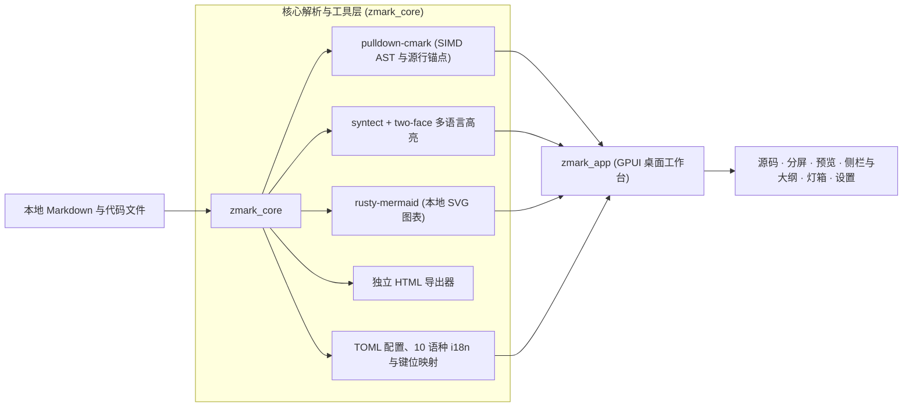

<div align="center">


# ZMark

**基于 Rust 与 GPUI 打造的原生极速本地 Markdown 编辑器、阅读工作台与 Mermaid 图表工作室。**

[](https://github.com/2716190547/zmark-releases/releases)
[](https://github.com/2716190547/zmark/actions/workflows/build-desktop.yml)
[](rust-toolchain.toml)
[](https://crates.io/crates/gpui)
[](#下载与安装)
[](#核心特性)

[简体中文](README.zh-CN.md) · [English](README.md) · [下载安装包](https://github.com/2716190547/zmark-releases/releases/tag/v0.2.10) · [Gitee 国内镜像](https://gitee.com/zeng_sc/zmark-releases/releases) · [源码仓库 (`dev`)](https://github.com/2716190547/zmark)

</div>

---

## 为什么选择 ZMark？

**ZMark** 是一款专注于**本机文件、瞬时响应与原生排印质感**的桌面 Markdown 与纯文本工作台，告别浏览器内核高内存占用与云端账号绑定。

- **GPU 原生桌面界面**：采用 Rust 与 **GPUI** 构建，冷启动毫秒级响应，长篇技术文档、多代码块与复杂流程图滚动丝滑跟手。
- **按语法块对齐的分屏预览**：支持**源码 / 分屏 / 预览**三大视图随时切换，分屏模式下双侧按语法块位置精确对齐并平滑同步滚动。
- **原生 Mermaid 图表与高清灯箱**：无需外接浏览器，全本机将 Mermaid 流程图渲染为矢量 SVG；点击任意本地图片或流程图即可开启支持缩放与拖拽的高清灯箱。
- **纯本地文件夹与草稿工作流**：在一个侧栏里同时管理多个工作区文件夹、外部单文件与未保存草稿，数据完全保存在您的磁盘中。

---

## 核心特性

| 模块 | 能力说明 |
| --- | --- |
| **写作视图与同步滚动** | 支持 **源码**、**左右分屏** 与 **纯净预览** 一键切换；分屏模式提供按语法块精确对齐的平滑同步滚动；支持将 `.md` 文件、文件夹或本地图片直接拖拽进窗口打开；支持定时自动保存与窗口失焦保存。 |
| **Markdown 与源码支持** | 完整支持标题、粗体/斜体/删除线、引用块、多层有序与无序列表、交互式任务清单（`[ ]` / `[x]`）、对齐表格、分隔线及多语言代码块高亮（右上角一键复制）；非 Markdown 文件（Rust、Python、TypeScript/JS、C/C++、Java、Go、JSON、YAML、TOML、HTML/CSS、Shell 等）自动进入带行号的源码编辑模式。 |
| **Mermaid 与本地媒体** | 基于 `rusty-mermaid` 本机渲染流程图（内置 UTF-8 中文节点修复）；支持 PNG / JPEG / GIF / WebP 本地图片（相对文档路径或绝对路径，macOS 大图使用原生 ImageIO 缩略解码）；点击任意图表或图片进入 HiDPI 灯箱放大检视。 |
| **工作区侧栏与大纲检索** | 侧栏分工作区文件夹、外部文件与草稿三组展示；支持按文件名实时模糊过滤，并可通过快捷键在**文件夹树**与**文档标题大纲**间快速互切；支持 Shift / Cmd / Ctrl 多选、批量移除（5 秒内可撤销）、移入废纸篓、双击标题原地重命名以及文档内高亮查找。 |
| **主题调色板与字体排印** | 支持浅色 / 深色 / 跟随系统；内置 **7 套精选主题**（克劳德温润、macOS 原生、东京之夜、北欧极简、GitHub 浅色、柔和浅黄、暗色极客）并提供浅色/深色独立的 **19 项完整颜色自定义编辑器**；可调节字体、字号、阅读栏宽、行高、Tab 缩进、行号显示与减少动态效果。 |
| **可自定义快捷键与引导** | 内置 **17 项可点击重录快捷键**，支持 `Backspace` 清空、`Esc` 取消以及冲突检测一键覆盖；首次启动提供具名欢迎示范文档（`欢迎使用 ZMark.md`）与 4 步交互式新手引导（可在「设置 → 关于」中随时重新观看）。 |
| **多语言与 HTML 导出** | 界面与欢迎文档全面覆盖 **10 种语言**（跟随系统、简体中文、繁體中文、English、日本語、한국어、Français、Deutsch、Español、Русский、Português），并支持一键导出排版美观的独立 HTML。 |

---

## 架构与技术栈



| 层级 | 核心组件 | 在 ZMark 中的职责 |
| --- | --- | --- |
| **语言与工具链** | **Rust `1.100.0`** | 统一产出 macOS、Windows 与 Linux 原生二进制（版本由 `rust-toolchain.toml` 锁定）。 |
| **桌面 UI 引擎** | **GPUI** (`gpui-pre =0.3.12`, `gpui-component =0.9.1`) | GPU 硬件加速窗口绘制、跨平台文字排版、动作级快捷键分发与取色器组件。 |
| **Markdown 与同步锚点** | **`pulldown-cmark 0.13`** (SIMD) | 高性能 CommonMark / GFM 解析并生成源码行锚点，驱动分屏平滑对齐滚动。 |
| **代码语法高亮** | **`syntect 5.3`** + **`two-face 0.5.2`** | 覆盖主流编程语言与标记语言高亮（macOS 启用 `onig`，Windows/Linux 启用 `fancy-regex`）。 |
| **Mermaid 与矢量渲染** | **`rusty-mermaid 0.2.0`** + **`usvg 0.45.1`** | 本地将 Mermaid 转为 SVG（附带仓库内中文 UTF-8 修复补丁）并按显示尺寸 HiDPI 栅格化。 |
| **本地图像解码** | **`image 0.25.10`** + macOS ImageIO | 高效解码 PNG、JPEG、GIF、WebP，按纹理预算控制内存并在切走或隐藏时及时释放。 |
| **配置与发布校验** | **`serde`**, **`toml 0.8`**, **`serde_json`**, **`ring`** | 管理 `config.toml` 用户偏好、稀疏快捷键覆写与带签名更新校验。 |

### 代码目录结构

```text
ZMark/
├── crates/
│   ├── zmark_core/        # Markdown AST 与行锚点、HTML 导出、Mermaid、syntect、i18n、配置持久化
│   ├── zmark_app/         # GPUI 桌面工作台、源码/分屏/预览、侧栏与大纲、灯箱与设置窗口
│   └── release_tool/      # 发行打包与签名更新清单工具
├── vendor/
│   └── rusty-mermaid-diagrams/  # 修复 Mermaid 非 ASCII / 中文字符切片越界问题的本地补丁
├── packaging/             # macOS Bundle、Windows Inno Setup 与 Linux 桌面打包配置
├── scripts/               # 本机打包脚本 (bundle_macos.sh)、全量门禁 (full_gate.sh) 与发布脚本
└── docs/                  # 版本更新说明、架构决策记录 (ADR) 与测试维护规范
```

---

## 下载与安装

**当前最新版本：`v0.2.10`** · [版本更新说明](https://github.com/2716190547/zmark/blob/dev/docs/releases/v0.2.10.md) · [对应源码 `309d05e`](https://github.com/2716190547/zmark/tree/309d05eb6b934c0d94430d40ca42f71525a798c3)

可从 [GitHub Releases](https://github.com/2716190547/zmark-releases/releases/tag/v0.2.10) 下载对应系统安装包；国内网络也可通过 [Gitee 发行镜像](https://gitee.com/zeng_sc/zmark-releases/releases) 获取 macOS ZIP、Windows 安装包与签名更新清单（DMG 与 Linux 安装包请前往 GitHub 下载）。

| 平台 | 架构 | 安装包格式 | 安装说明 |
| --- | --- | --- | --- |
| **macOS** | Apple Silicon (`arm64`) | `.zip` / `.dmg` | 解压或打开镜像，将 `ZMark.app` 拖入「应用程序」目录即可。 |
| **Windows** | `x86_64` | Setup `.exe` | 双击运行安装向导完成安装。 |
| **Linux** | `x86_64` | `.deb` / `.tar.gz` | 通过 `apt` / `dpkg` 安装 `.deb`，或解压压缩包后运行 `usr/bin/zmark_app`。 |

> [!NOTE]
> macOS 应用包当前为 Ad-Hoc 本地签名（未经过 Apple 公证），Windows 安装程序暂无商业发布者代码签名。预览窗格出于隐私与性能考虑不请求远程网络图片 URL，请使用相对当前文档路径或绝对路径引用本地图片。导出 HTML 会内嵌排版样式表，图片路径保持引用不变，Mermaid 块保留为代码形式。

---

## 默认快捷键速查

以下所有操作均可在应用内「**设置 → 快捷键**」中点击按钮重新录制（`Backspace` 清空、`Esc` 取消，支持冲突替换）：

| 操作 | macOS | Windows / Linux |
| --- | --- | --- |
| 打开文件 | `Cmd+O` | `Ctrl+O` |
| 新建草稿 | `Cmd+N` | `Ctrl+N` |
| 保存文档 | `Cmd+S` | `Ctrl+S` |
| 关闭当前文档 | `Cmd+W` | `Ctrl+W` |
| 导出独立 HTML | `Cmd+Shift+E` | `Ctrl+Shift+E` |
| 源码 / 分屏 / 预览模式 | `Cmd+1` / `Cmd+2` / `Cmd+3` | `Ctrl+1` / `Ctrl+2` / `Ctrl+3` |
| 展开 / 收起侧栏 | `Cmd+Shift+B` | `Ctrl+Shift+B` |
| 切换文件夹与文档大纲 | `Cmd+Shift+O` | `Ctrl+Shift+O` |
| 撤销侧栏移除（5 秒内） | `Cmd+Option+Z` | `Ctrl+Alt+Z` |
| 打开设置窗口 | `Cmd+,` | `Ctrl+,` |
| 当前文档内查找 | `Cmd+F` | `Ctrl+F` |
| 下一个 / 上一个匹配 | `Cmd+G` / `Cmd+Shift+G`（或 `F3` / `Shift+F3`） | `Ctrl+G` / `Ctrl+Shift+G`（或 `F3` / `Shift+F3`） |
| 加粗（Markdown） | `Cmd+B` | `Ctrl+B` |
| 有序列表（Markdown） | `Cmd+Shift+7` | `Ctrl+Shift+7` |
| 退出多选 / 关闭查找 / 关闭弹窗 | `Esc` | `Esc` |

---

## 从源码构建

开发分支位于公开仓库的 `dev` 分支。项目通过 `rust-toolchain.toml` 锁定 **Rust `1.100.0`**，`rustup` 会自动切换到正确版本：

```sh
git clone --branch dev https://github.com/2716190547/zmark.git
cd zmark
cargo run -p zmark_app
```

Linux 等平台的系统构建依赖见 [`.github/workflows/build-desktop.yml`](.github/workflows/build-desktop.yml)。

### 常用开发与构建脚本

- **开发期并行与分组快速测试（支持 `all|fast|core|state|editor|preview|media|lightbox|obs`）**：
  ```sh
  ./scripts/dev_check.sh fast
  ```
- **macOS 本机构建并安装到 `/Applications/ZMark.app`**：
  ```sh
  ./scripts/bundle_macos.sh --install
  ```
- **发布前全量门禁校验（workspace 全量测试 + Phase H/I 专项 + 打包）**：
  ```sh
  ./scripts/full_gate.sh --bundle
  ```
- **发布与性能文档**：参阅 [`docs/releases/README.md`](docs/releases/README.md) 与 [`docs/plans/theme-selection-and-memory-audit.md`](docs/plans/theme-selection-and-memory-audit.md)。
