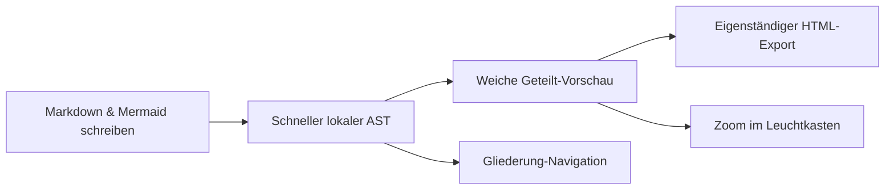

# Willkommen bei ZMark

> Ein schneller, nativer lokaler Markdown-Editor und Lese-Arbeitsbereich auf Basis von **Rust + GPUI**.  
> Bearbeiten Sie dieses Dokument links und verfolgen Sie die blockgenaue Vorschau mit weichem Synchronscrollen rechts.

---

## 1. Schnelleinstieg: Was ZMark kann

1. **Dateien öffnen & Entwürfe verwalten**: Öffnen Sie mit `Cmd+O` lokale `.md`-Dateien, erstellen Sie mit `Cmd+N` neue Entwürfe oder **ziehen Sie Markdown-Dateien und lokale Bilder direkt per Drag & Drop** ins Fenster.
2. **Drei Ansichtsmodi**: Wechseln Sie blitzschnell zwischen **Quelltext** (`Cmd+1`), **Geteilt** (`Cmd+2`) und **Vorschau** (`Cmd+3`) inklusive weichem Synchronscrollen.
3. **Ordner-Arbeitsbereiche & Gliederung**: Öffnen Sie mit `Cmd+Shift+B` die Seitenleiste, fügen Sie lokale Ordner mit Sofortsuche hinzu und wechseln Sie mit `Cmd+Shift+O` zwischen **Dateien** und **Gliederung**.
4. **Speichern, Umbenennen & HTML-Export**: `Cmd+S` speichert, ein **Doppelklick auf den Titel** benennt direkt um, und `Cmd+Shift+E` exportiert eigenständiges HTML.
5. **Farbpaletten & anpassbare Kürzel**: `Cmd+,` öffnet die Einstellungen mit 7 hellen/dunklen Designs, komplett freien Farben und **per Klick aufnehmbaren Tastenkürzeln**.
6. **HiDPI-Leuchtkasten**: Klicken Sie auf lokale Bilder oder Mermaid-Diagramme in der Vorschau, um sie stufenlos zu vergrößern.

---

## 2. Gängige Markdown-Syntax im Überblick

Testen Sie beliebige Änderungen direkt im Editor:

### 1. Textformatierung, Zitate & Links

- Auszeichnungen: **Fett**, *Kursiv*, ~~Durchgestrichen~~ und `Inline-Code`.
- Schreibkürzel: `Cmd+B` für Fett, `Cmd+Shift+7` für nummerierte Listen.
- Suche im Dokument: `Cmd+F` öffnet die Suche, `Cmd+G` / `Cmd+Shift+G` springt zu Treffern.
- Links: [ZMark auf GitHub](https://github.com/2716190547/zmark) · [Releases](https://github.com/2716190547/zmark-releases)

> **Lokal zuerst:** ZMark rendert Tabellen, Aufgabenlisten, mehrsprachiges Syntax-Highlighting, lokale Bilder und Mermaid-Diagramme in Millisekunden vollständig offline.

### 2. Listen & Aufgaben

- [x] ZMark starten und `Willkommen bei ZMark.md` ansehen
- [ ] Seitenleiste mit `Cmd+Shift+B` öffnen und einen Ordner hinzufügen
- [ ] In `Cmd+,` ein Design wählen oder ein Tastenkürzel neu belegen
  - Verschachtelter Listenpunkt mit automatischer Einrückung
  - `[ ]` im Quelltext durch `[x]` ersetzen, um Aufgaben abzuhaken

### 3. Kernfunktionen & Standardkürzel

| Funktion | Standardkürzel (Mac / Win & Linux) | Beschreibung |
| --- | --- | --- |
| Öffnen / Neuer Entwurf | `Cmd+O` / `Cmd+N` | Dateien und ungespeicherte Entwürfe parallel nutzen |
| Quelltext / Geteilt / Vorschau | `Cmd+1` / `Cmd+2` / `Cmd+3` | Weiches, blockgenaues Synchronscrollen |
| Seitenleiste / Gliederung | `Cmd+Shift+B` / `Cmd+Shift+O` | Ordnerbaum, Suche & Überschriften-Sprung |
| Im Dokument suchen | `Cmd+F` (`Cmd+G` weiter) | Live-Trefferzahl und schnelle Navigation |
| Eigenständiges HTML exportieren | `Cmd+Shift+E` | Eigenständiges HTML mit integriertem Stylesheet |
| Einstellungen öffnen | `Cmd+,` | Paletten, Typografie & Tastenkürzel-Editor |

### 4. Codeblöcke mit Syntax-Highlighting

```rust
fn main() {
    let app = "ZMark";
    let stack = ["Rust", "GPUI", "pulldown-cmark", "rusty-mermaid"];
    println!("{app} built with {stack:?}");
}
```

```json
{
  "editor": "ZMark",
  "views": ["source", "split", "preview"],
  "customizableShortcuts": true,
  "localOnly": true
}
```

### 5. Native Mermaid-Diagramme (zum Vergrößern anklicken)


