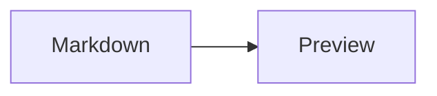

# Willkommen bei ZMark

Lokale Markdown-Dateien schreiben, lesen und organisieren.

## Erste Schritte

1. Öffne eine Markdown-Datei mit `Cmd+O` oder bearbeite diesen Willkommensentwurf.
2. Wechsle mit `Cmd+1`, `Cmd+2` und `Cmd+3` zwischen Quelltext, geteilter Ansicht und Vorschau.
3. Öffne mit `Cmd+B` die Seitenleiste, füge Ordner hinzu, suche nach Dateinamen und nutze die Gliederung.
4. Speichere mit `Cmd+S`; für einen neuen Entwurf wählst du zuerst einen Speicherort. Ein Doppelklick auf den Titel benennt ihn um.
5. Öffne die Einstellungen mit `Cmd+,` und exportiere HTML mit `Cmd+Shift+E`.

## Hier ausprobieren

Bearbeite die Beispiele und beobachte die Vorschau.

- [ ] Eine Aufgabe ausprobieren

| Funktion | Beispiel |
| --- | --- |
| Text | **Fett**, *kursiv* und `Code` |

```rust
fn main() {
    println!("Hello, ZMark!");
}
```


