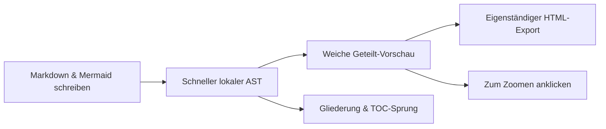

# Willkommen bei ZMark


> Ein schneller, nativer lokaler Markdown-Editor und Lese-Arbeitsbereich auf Basis von **Rust + GPUI**.<br/>Bearbeiten Sie beliebigen Markdown-Text links und erleben Sie die blockgenau synchronisierte Vorschau rechts.

[toc]

---

## 1. Was ZMark alles kann


1. **Dateien & Entwürfe verwalten**: Öffnen Sie mit `Cmd+O` lokale `.md`-Dateien, erstellen Sie mit `Cmd+N` Entwürfe oder **ziehen Sie Dateien, Ordner und Bilder per Drag & Drop** direkt ins Fenster.
2. **Drei Ansichtsmodi**: Wechseln Sie blitzschnell zwischen **Quelltext** (`Cmd+1`), **Geteilt** (`Cmd+2`) und **Vorschau** (`Cmd+3`) mit weichem Synchronscrollen.
3. **Seitenleiste & Klickbares Inhaltsverzeichnis**: `Cmd+Shift+B` öffnet die Seitenleiste, `Cmd+Shift+O` wechselt zwischen **Dateien** und **Gliederung** — und `[toc]` rendert direkt eine kompakte Sprungliste im Text.
4. **Speichern, Umbenennen & HTML-Export**: `Cmd+S` speichert, ein **Doppelklick auf den Titel** benennt um und `Cmd+Shift+E` exportiert eigenständiges HTML.
5. **7 Farbpaletten & freie Tastenkürzel**: `Cmd+,` öffnet die Einstellungen mit 19 Farbwerten und **17 per Klick neu aufnehmbaren Tastenkürzeln**.
6. **Vektor-SVG & HiDPI-Leuchtkasten**: Klicken Sie auf lokale Bilder, Vektorgrafiken oder Mermaid-Diagramme, um sie im Leuchtkasten stufenlos zu zoomen.

---

## 2. Interaktiver Markdown-Syntax-Baukasten


### 1. Textformatierung, Zeilenumbrüche, Zitate & Links

- Auszeichnungen: **Fett**, *Kursiv*, ~~Durchgestrichen~~ und `Inline-Code`.
- HTML `<br/>`: `<br/>` im Fließtext erzwingt einen Umbruch, allein in einer Zeile schafft es großzügigen Abstand.
- Kürzel & Suche: `Cmd+B` für Fett, `Cmd+Shift+7` für nummerierte Listen, `Cmd+F` (`Cmd+G` / `Cmd+Shift+G`) für Suche.
- Links: [ZMark auf GitHub](https://github.com/2716190547/zmark) · [Releases](https://github.com/2716190547/zmark-releases)

> **100 % lokal:** ZMark rendert adaptive Tabellen, Aufgabenlisten, mehrsprachiges Syntax-Highlighting, SVGs und Mermaid-Diagramme offline in Millisekunden.

### 2. Listen & interaktive Aufgaben

- [x] ZMark starten und `Willkommen bei ZMark.md` ansehen
- [ ] Oben im `[toc]`-Kasten auf eine Überschrift klicken, um dorthin zu springen
- [ ] Seitenleiste mit `Cmd+Shift+B` öffnen und einen Ordner hinzufügen
- [ ] In `Cmd+,` ein Design wählen oder ein Tastenkürzel neu belegen
  - Verschachtelte Listenpunkte rücken automatisch ein
  - Ersetzen Sie `[ ]` links durch `[x]`, um Aufgaben live abzuhaken

### 3. Adaptive Tabellen & Standardkürzel

| Funktion | Standardkürzel (Mac / Win & Linux) | Beschreibung |
| --- | --- | --- |
| Öffnen / Neuer Entwurf | `Cmd+O` / `Cmd+N` | Dateien und ungespeicherte Entwürfe parallel nutzen |
| Quelltext / Geteilt / Vorschau | `Cmd+1` / `Cmd+2` / `Cmd+3` | Weiches, blockgenaues Synchronscrollen |
| Seitenleiste / Gliederung | `Cmd+Shift+B` / `Cmd+Shift+O` | Ordnerbaum, Suche & Überschriften-Sprung |
| Im Dokument suchen | `Cmd+F` (`Cmd+G` weiter) | Live-Trefferzahl und schnelle Navigation |
| Eigenständiges HTML exportieren | `Cmd+Shift+E` | Eigenständiges HTML mit integriertem Stylesheet |
| Einstellungen öffnen | `Cmd+,` | Paletten, Typografie & Tastenkürzel-Editor |

### 4. Codeblöcke mit Syntax-Highlighting

```rust
fn main() {
    let app = "ZMark";
    let stack = ["Rust", "GPUI", "pulldown-cmark", "rusty-mermaid"];
    println!("{app} built with {stack:?}");
}
```

```json
{
  "editor": "ZMark",
  "views": ["source", "split", "preview"],
  "tocBlock": true,
  "vectorSvgLightbox": true
}
```

### 5. Ausprobieren: Vektor-Postkarte unten zum Zoomen anklicken!


<br/>

### 6. Native Mermaid-Diagramme (ebenfalls klickbar)


