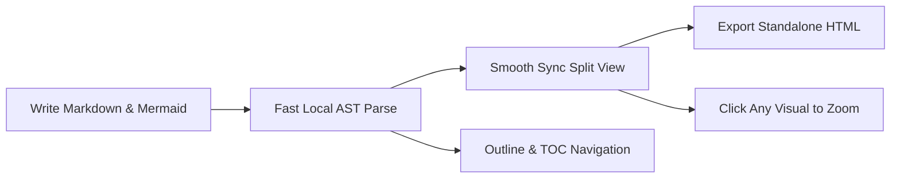

# Welcome to ZMark


> A fast, native local Markdown editor and reading workspace built with **Rust + GPUI**.<br/>Edit any Markdown on the left and watch the block-aligned live preview respond smoothly on the right.

[toc]

---

## 1. What ZMark Can Do


1. **Open Files & Manage Drafts**: Press `Cmd+O` to open a local `.md` file, press `Cmd+N` to start a draft, or simply **drag & drop Markdown files, folders, and local images** straight into the window.
2. **Three Instant View Modes**: Switch effortlessly between **Source** (`Cmd+1`), **Split** (`Cmd+2`), and **Preview** (`Cmd+3`) with smooth block-aligned synchronized scrolling.
3. **Workspace Sidebar & Interactive TOC**: Press `Cmd+Shift+B` to toggle the sidebar, attach folders with instant fuzzy search, and press `Cmd+Shift+O` to flip between **Files** and **Outline** — plus inline `[toc]` markers render as clickable directory cards right inside your document.
4. **Save, Rename & Standalone Export**: Press `Cmd+S` to save, **double-click the header title** to rename inline, and press `Cmd+Shift+E` to export clean, self-contained HTML.
5. **7 Palettes & Rebindable Shortcuts**: Press `Cmd+,` for Settings — pick from 7 curated light/dark palettes, customize 19 color slots, and **click any shortcut pill to record your own keybindings**.
6. **Vector SVG & HiDPI Lightbox**: Click any local image, built-in vector illustration, or Mermaid diagram to open the **zoomable HiDPI lightbox**.

---

## 2. Common Markdown Syntax Playground


### 1. Text Formatting, Line Breaks, Quotes & Links

- Inline styling: **Bold text**, *italic text*, ~~strikethrough~~, and `inline code`.
- HTML `<br/>` support: Use `<br/>` inline to force a line break, or on its own line to add clean vertical breathing room.
- Editing & search shortcuts: `Cmd+B` toggles bold, `Cmd+Shift+7` toggles numbered lists; `Cmd+F` finds in document (`Cmd+G` / `Cmd+Shift+G` next/previous).
- Project links: [ZMark on GitHub](https://github.com/2716190547/zmark) · [Releases](https://github.com/2716190547/zmark-releases)

> **Local-first by design:** ZMark renders adaptive tables, task lists, multi-language code blocks, vector SVGs, and Mermaid diagrams 100% locally in milliseconds.

### 2. Lists & Interactive Checklists

- [x] Launch ZMark and explore `Welcome to ZMark.md`
- [ ] Click any heading in the inline Table of Contents card above to jump
- [ ] Press `Cmd+Shift+B` to open the sidebar and add a local folder
- [ ] Press `Cmd+,` to switch palettes or record custom shortcuts
  - Nested items indent and continue automatically
  - Change `[ ]` to `[x]` on the left to check off tasks live

### 3. Adaptive Tables & Default Shortcuts

| Feature | Default Shortcut (Mac / Win & Linux) | Notes |
| --- | --- | --- |
| Open File / New Draft | `Cmd+O` / `Cmd+N` | Work with folders and scratch drafts side by side |
| Source / Split / Preview | `Cmd+1` / `Cmd+2` / `Cmd+3` | Smooth block-aligned sync scrolling in Split view |
| Sidebar / Toggle Outline | `Cmd+Shift+B` / `Cmd+Shift+O` | Fast folder tree, fuzzy filter & heading outline |
| Find in Document | `Cmd+F` (`Cmd+G` next) | Live match counter and highlighted jumps |
| Export Standalone HTML | `Cmd+Shift+E` | Clean standalone HTML with embedded typography CSS |
| Open Settings | `Cmd+,` | Custom theme editor, typography & shortcut rebinding |

### 4. Syntax-Highlighted Code Blocks (One-Click Copy)

```rust
fn main() {
    let app = "ZMark";
    let stack = ["Rust", "GPUI", "pulldown-cmark", "rusty-mermaid"];
    println!("{app} built with {stack:?}");
}
```

```json
{
  "editor": "ZMark",
  "views": ["source", "split", "preview"],
  "tocBlock": true,
  "vectorSvgLightbox": true
}
```

### 5. Try It: Click the Vector Postcard Below to Zoom!


<br/>

### 6. Native Mermaid Diagrams (Click to Zoom Too)


