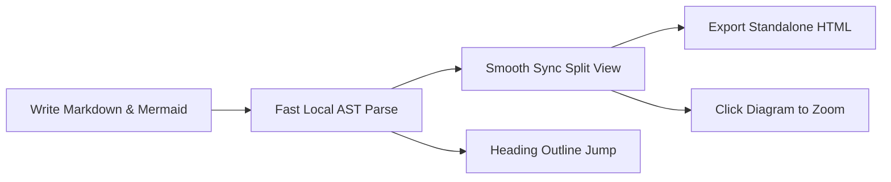

# Welcome to ZMark

> A fast, native local Markdown editor and reading workspace built with **Rust + GPUI**.  
> Edit anything in this welcome document on the left and watch the live, block-aligned preview respond smoothly on the right.

---

## 1. Quick Start: What ZMark Can Do

1. **Open Files & Manage Drafts**: Press `Cmd+O` to open a local Markdown file, press `Cmd+N` to start a new draft, or simply **drag and drop `.md` files and local images** straight into the window.
2. **Three Instant View Modes**: Switch effortlessly between **Source** (`Cmd+1`), **Split** (`Cmd+2`), and **Preview** (`Cmd+3`). Split view uses block-accurate, smooth synchronized scrolling.
3. **Workspace Sidebar & Document Outline**: Press `Cmd+Shift+B` to toggle the sidebar, attach local folders with instant search, and press `Cmd+Shift+O` to flip between **Files** and **Outline** for one-click heading navigation.
4. **Save, Rename & Standalone Export**: Press `Cmd+S` to save (drafts prompt for a location), **double-click the header title** to rename inline, and press `Cmd+Shift+E` to export clean, self-contained HTML.
5. **Themes & Rebindable Shortcuts**: Press `Cmd+,` for Settings — choose from 7 light/dark palettes, customize every color slot, and **click any shortcut pill to record your own keybindings**.
6. **HiDPI Lightbox & Diagrams**: Click any local image or Mermaid diagram in the preview pane to open the **interactive zoomable lightbox**.

---

## 2. Common Markdown Syntax Showcase

Try modifying any example below in Source or Split view:

### 1. Text Formatting, Quotes & Links

- Inline emphasis: **Bold text**, *italic text*, ~~strikethrough~~, and `inline code`.
- Quick editing shortcuts: `Cmd+B` toggles bold, `Cmd+Shift+7` toggles a numbered list.
- In-file search: `Cmd+F` opens find, `Cmd+G` / `Cmd+Shift+G` jumps to next or previous matches.
- Links: [ZMark on GitHub](https://github.com/2716190547/zmark) · [Releases](https://github.com/2716190547/zmark-releases)

> **Local-first by design:** ZMark renders GitHub Flavored Markdown tables, task lists, multi-language syntax highlighting, local images, and Mermaid diagrams 100% locally in milliseconds with zero telemetry or cloud dependencies.

### 2. Lists & Interactive Tasks

- [x] Launch ZMark and explore `Welcome to ZMark.md`
- [ ] Press `Cmd+Shift+B` to open the sidebar and add a workspace folder
- [ ] Press `Cmd+,` to try another palette or rebind a keyboard shortcut
  - Nested bullet point with automatic indentation
  - Change `[ ]` to `[x]` in the source editor to check off a task

### 3. Core Actions & Default Shortcuts

| Capability | Default Shortcut (Mac / Win & Linux) | Notes |
| --- | --- | --- |
| Open File / New Draft | `Cmd+O` / `Cmd+N` | Work with folders and scratch drafts side by side |
| Source / Split / Preview | `Cmd+1` / `Cmd+2` / `Cmd+3` | Smooth block-aligned sync scrolling in Split view |
| Sidebar / Switch to Outline | `Cmd+Shift+B` / `Cmd+Shift+O` | Fast folder tree, fuzzy filter & heading outline |
| Find in Document | `Cmd+F` (`Cmd+G` next) | Highlighted matches with instant jump controls |
| Export Standalone HTML | `Cmd+Shift+E` | Standalone single-file HTML with embedded CSS |
| Open Settings | `Cmd+,` | Custom theme editor, typography & shortcut rebinding |

### 4. Syntax-Highlighted Code Blocks (with One-Click Copy)

```rust
fn main() {
    let app = "ZMark";
    let stack = ["Rust", "GPUI", "pulldown-cmark", "rusty-mermaid"];
    println!("{app} built with {stack:?}");
}
```

```json
{
  "editor": "ZMark",
  "views": ["source", "split", "preview"],
  "customizableShortcuts": true,
  "localOnly": true
}
```

### 5. Native Mermaid Diagrams (Click to Zoom in Lightbox)


