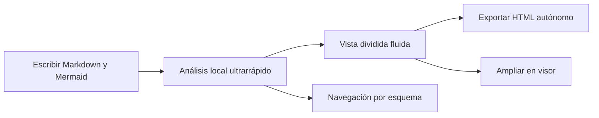

# Bienvenido a ZMark

> Un editor de Markdown local y espacio de lectura nativo de alta velocidad construido con **Rust + GPUI**.  
> Edita este documento a la izquierda y mira cómo la vista previa sincronizada responde al instante a la derecha.

---

## 1. Primeros pasos: qué puedes hacer con ZMark

1. **Abrir archivos y crear borradores**: pulsa `Cmd+O` para abrir archivos `.md`, `Cmd+N` para crear un borrador o **arrastra y suelta archivos Markdown e imágenes locales** dentro de la ventana.
2. **Tres modos de vista**: alterna al instante entre **Código** (`Cmd+1`), **Dividida** (`Cmd+2`) y **Vista previa** (`Cmd+3`), con desplazamiento sincronizado y suave por bloques.
3. **Carpetas de trabajo y esquema**: pulsa `Cmd+Shift+B` para abrir la barra lateral, añadir carpetas con búsqueda rápida y pulsar `Cmd+Shift+O` para cambiar entre **Archivos** y **Esquema**.
4. **Guardar, renombrar y exportar**: guarda con `Cmd+S`, haz **doble clic en el título** para renombrarlo y pulsa `Cmd+Shift+E` para exportar un HTML autónomo.
5. **Temas y atajos personalizables**: pulsa `Cmd+,` para abrir Ajustes — 7 paletas claras/oscuras, colores editables y **atajos regrabables con un clic**.
6. **Visor HiDPI**: haz clic en cualquier imagen local o diagrama Mermaid para ampliarlo con zoom.

---

## 2. Galería de sintaxis Markdown habitual

Prueba a editar cualquier bloque inferior:

### 1. Formato de texto, citas y enlaces

- Estilos disponibles: **negrita**, *cursiva*, ~~tachado~~ y `código en línea`.
- Atajos de escritura: `Cmd+B` para negrita y `Cmd+Shift+7` para lista numerada.
- Búsqueda interna: `Cmd+F` abre el buscador; `Cmd+G` / `Cmd+Shift+G` salta entre coincidencias.
- Enlaces: [ZMark en GitHub](https://github.com/2716190547/zmark) · [Versiones](https://github.com/2716190547/zmark-releases)

> **100 % local:** ZMark renderiza tablas, listas de tareas, resaltado de código, imágenes locales y diagramas Mermaid sin conexión en milisegundos.

### 2. Listas y tareas

- [x] Abrir ZMark y explorar `Bienvenido a ZMark.md`
- [ ] Pulsar `Cmd+Shift+B` para añadir una carpeta de trabajo
- [ ] Entrar en `Cmd+,` para probar otra paleta o cambiar un atajo
  - Elemento anidado con sangría automática
  - Cambia `[ ]` por `[x]` en el código fuente para completar la tarea

### 3. Funciones clave y atajos predeterminados

| Función | Atajo (Mac / Win & Linux) | Detalle |
| --- | --- | --- |
| Abrir / Nuevo borrador | `Cmd+O` / `Cmd+N` | Gestiona archivos locales y borradores a la vez |
| Código / Dividida / Vista previa | `Cmd+1` / `Cmd+2` / `Cmd+3` | Desplazamiento suave sincronizado por bloque |
| Barra lateral / Esquema | `Cmd+Shift+B` / `Cmd+Shift+O` | Árbol de carpetas, filtro y salto por títulos |
| Buscar en el documento | `Cmd+F` (`Cmd+G` siguiente) | Coincidencias resaltadas al instante |
| Exportar HTML autónomo | `Cmd+Shift+E` | HTML autónomo con estilos tipográficos integrados |
| Ajustes | `Cmd+,` | Editor de temas, tipografía y atajos |

### 4. Bloques de código resaltados (con copia rápida)

```rust
fn main() {
    let app = "ZMark";
    let stack = ["Rust", "GPUI", "pulldown-cmark", "rusty-mermaid"];
    println!("{app} built with {stack:?}");
}
```

```json
{
  "editor": "ZMark",
  "views": ["source", "split", "preview"],
  "customizableShortcuts": true,
  "localOnly": true
}
```

### 5. Diagramas Mermaid nativos (clic para ampliar)


