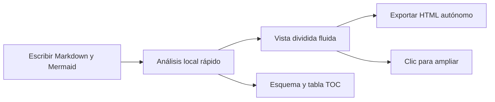

# Bienvenido a ZMark


> Un editor de Markdown local y espacio de lectura nativo ultrarrápido construido con **Rust + GPUI**.<br/>Edita cualquier línea a la izquierda y mira cómo la vista previa responde con desplazamiento suave sincronizado a la derecha.

[toc]

---

## 1. Qué puedes hacer con ZMark

1. **Archivos locales y borradores**: pulsa `Cmd+O` para abrir un `.md`, `Cmd+N` para crear un borrador o **arrastra y suelta archivos, carpetas e imágenes** dentro de la ventana.
2. **Tres modos de vista**: cambia al instante entre **Código** (`Cmd+1`), **Dividida** (`Cmd+2`) y **Vista previa** (`Cmd+3`) con sincronización fluida por bloques.
3. **Barra lateral y tabla de contenidos `[toc]`**: `Cmd+Shift+B` abre las carpetas y `Cmd+Shift+O` alterna con **Esquema**; además, `[toc]` crea un índice compacto clicable en el documento.
4. **Guardar, renombrar y exportar HTML**: `Cmd+S` guarda, un **doble clic en el título** renombra en el acto y `Cmd+Shift+E` exporta HTML autónomo.
5. **7 paletas y atajos personalizables**: pulsa `Cmd+,` para personalizar 19 colores y **17 atajos regrabables con un clic**.
6. **SVG vectorial y visor HiDPI**: haz clic en imágenes locales, gráficos SVG o diagramas Mermaid para abrir el visor con zoom.

---

## 2. Demostración de sintaxis Markdown

### 1. Estilos de texto, saltos `<br/>`, citas y enlaces

- Formato en línea: **negrita**, *cursiva*, ~~tachado~~ y `código en línea`.
- HTML `<br/>`: añade `<br/>` dentro de un párrafo para saltar de línea o en su propia línea para dar respiro vertical.
- Escritura y búsqueda: `Cmd+B` negrita, `Cmd+Shift+7` lista numerada, `Cmd+F` (`Cmd+G` / `Cmd+Shift+G`) buscar.
- Enlaces: [ZMark en GitHub](https://github.com/2716190547/zmark) · [Versiones](https://github.com/2716190547/zmark-releases)

> **100 % local:** ZMark renderiza tablas adaptativas, listas de tareas, resaltado de código, SVG y Mermaid sin conexión en milisegundos.

### 2. Listas y tareas interactivas

- [x] Abrir ZMark y explorar `Bienvenido a ZMark.md`
- [ ] Hacer clic en cualquier título del cuadro `[toc]` superior para saltar
- [ ] Pulsar `Cmd+Shift+B` y añadir una carpeta de trabajo
- [ ] Entrar en `Cmd+,` para cambiar de paleta o grabar tus atajos
  - Elementos anidados con sangría automática
  - Cambia `[ ]` por `[x]` a la izquierda para marcar la tarea en vivo

### 3. Tablas adaptativas y atajos predeterminados

| Función | Atajo (Mac / Win & Linux) | Detalle |
| --- | --- | --- |
| Abrir / Nuevo borrador | `Cmd+O` / `Cmd+N` | Gestiona archivos locales y borradores a la vez |
| Código / Dividida / Vista previa | `Cmd+1` / `Cmd+2` / `Cmd+3` | Desplazamiento suave sincronizado por bloque |
| Barra lateral / Esquema | `Cmd+Shift+B` / `Cmd+Shift+O` | Árbol de carpetas, filtro y salto por títulos |
| Buscar en el documento | `Cmd+F` (`Cmd+G` siguiente) | Coincidencias resaltadas al instante |
| Exportar HTML autónomo | `Cmd+Shift+E` | HTML autónomo con estilos tipográficos integrados |
| Ajustes | `Cmd+,` | Editor de temas, tipografía y atajos |

### 4. Bloques de código resaltados (con copia rápida)

```rust
fn main() {
    let app = "ZMark";
    let stack = ["Rust", "GPUI", "pulldown-cmark", "rusty-mermaid"];
    println!("{app} built with {stack:?}");
}
```

```json
{
  "editor": "ZMark",
  "views": ["source", "split", "preview"],
  "tocBlock": true,
  "vectorSvgLightbox": true
}
```

### 5. Pruébalo: ¡haz clic en la postal SVG para hacer zoom!


<br/>

### 6. Diagramas Mermaid nativos (también clicables)


