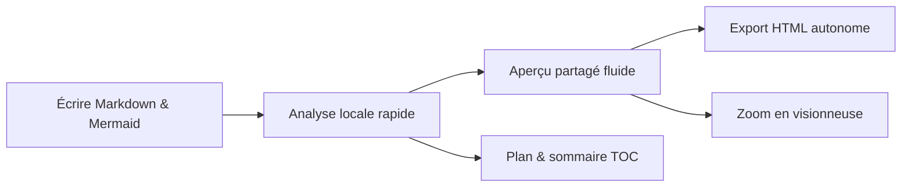

# Bienvenue dans ZMark


> Un éditeur Markdown local et espace de lecture natif ultra-rapide conçu avec **Rust + GPUI**.<br/>Modifiez librement ce document à gauche et observez l'aperçu synchronisé répondre bloc par bloc à droite.

[toc]

---

## 1. Prise en main : capacités clés de ZMark

1. **Fichiers locaux et brouillons** : `Cmd+O` ouvre un `.md`, `Cmd+N` crée un brouillon, ou **glissez-déposez des fichiers Markdown, dossiers et images** dans la fenêtre.
2. **Trois modes de vue** : alternez entre **Source** (`Cmd+1`), **Vue partagée** (`Cmd+2`) et **Aperçu** (`Cmd+3`) avec défilement fluide et synchronisé.
3. **Barre latérale et sommaire interactif** : `Cmd+Shift+B` ouvre la barre latérale et `Cmd+Shift+O` bascule entre **Fichiers** et **Plan** ; un marqueur `[toc]` génère aussi un bloc sommaire cliquable dans le document.
4. **Enregistrement, renommage et export HTML** : `Cmd+S` enregistre, un **double-clic sur le titre** renomme sur place, et `Cmd+Shift+E` exporte un HTML autonome.
5. **7 palettes et raccourcis personnalisables** : `Cmd+,` ouvre les paramètres avec 19 couleurs éditables et **17 raccourcis enregistrables au clic**.
6. **SVG vectoriel et visionneuse HiDPI** : cliquez sur une image locale, une illustration SVG ou un diagramme Mermaid pour l'ouvrir dans la visionneuse zoomable.

---

## 2. Galerie interactive de syntaxe Markdown

### 1. Mise en forme, retours à la ligne, citations et liens

- Styles en ligne : **gras**, *italique*, ~~barré~~ et `code en ligne`.
- Balises HTML `<br/>` : utilisez `<br/>` dans un paragraphe pour forcer un retour ou seul sur une ligne pour aérer.
- Édition et recherche : `Cmd+B` pour le gras, `Cmd+Shift+7` pour liste numérotée, `Cmd+F` (`Cmd+G` / `Cmd+Shift+G`) pour chercher.
- Liens : [Dépôt GitHub ZMark](https://github.com/2716190547/zmark) · [Versions publiées](https://github.com/2716190547/zmark-releases)

> **100 % local :** ZMark rend tableaux adaptatifs, tâches, code coloré, SVG vectoriels et diagrammes Mermaid hors ligne en quelques millisecondes.

### 2. Listes et tâches interactives

- [x] Lancer ZMark et découvrir `Bienvenue dans ZMark.md`
- [ ] Cliquer sur un titre du sommaire `[toc]` ci-dessus pour y sauter
- [ ] Appuyer sur `Cmd+Shift+B` pour ouvrir la barre latérale et ajouter un dossier
- [ ] Ouvrir `Cmd+,` pour changer de palette ou enregistrer vos propres raccourcis
  - Sous-éléments imbriqués avec indentation automatique
  - Remplacez `[ ]` par `[x]` à gauche pour cocher la tâche en direct

### 3. Tableaux adaptatifs et raccourcis par défaut

| Fonction | Raccourci (Mac / Win & Linux) | Détails |
| --- | --- | --- |
| Ouvrir / Nouveau brouillon | `Cmd+O` / `Cmd+N` | Travaillez sur vos dossiers et brouillons |
| Source / Partagé / Aperçu | `Cmd+1` / `Cmd+2` / `Cmd+3` | Défilement synchronisé et fluide |
| Barre latérale / Plan | `Cmd+Shift+B` / `Cmd+Shift+O` | Arborescence, filtre et titres cliquables |
| Rechercher dans le fichier | `Cmd+F` (`Cmd+G` suivant) | Compteur en direct et saut rapide |
| Export HTML autonome | `Cmd+Shift+E` | Page HTML autonome avec styles intégrés |
| Paramètres | `Cmd+,` | Couleurs personnalisées et raccourcis |

### 4. Blocs de code avec coloration syntaxique

```rust
fn main() {
    let app = "ZMark";
    let stack = ["Rust", "GPUI", "pulldown-cmark", "rusty-mermaid"];
    println!("{app} built with {stack:?}");
}
```

```json
{
  "editor": "ZMark",
  "views": ["source", "split", "preview"],
  "tocBlock": true,
  "vectorSvgLightbox": true
}
```

### 5. À vous : cliquez sur l'illustration SVG pour zoomer !


<br/>

### 6. Diagrammes Mermaid natifs (cliquer aussi pour zoomer)


