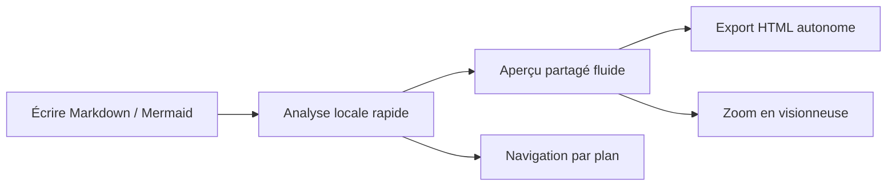

# Bienvenue dans ZMark

> Un éditeur Markdown local et espace de lecture natif ultra-rapide, conçu avec **Rust + GPUI**.  
> Modifiez librement ce document à gauche et observez l'aperçu synchronisé en temps réel sur la droite.

---

## 1. Prise en main : capacités clés de ZMark

1. **Ouvrir des fichiers et créer des brouillons** : appuyez sur `Cmd+O` pour ouvrir un fichier `.md`, `Cmd+N` pour créer un brouillon, ou **glissez-déposez des fichiers Markdown et images locales** directement dans la fenêtre.
2. **Trois modes de vue instantanés** : basculez entre **Source** (`Cmd+1`), **Vue partagée** (`Cmd+2`) et **Aperçu** (`Cmd+3`) avec un défilement synchronisé et fluide bloc par bloc.
3. **Dossiers de travail et plan du document** : appuyez sur `Cmd+Shift+B` pour ouvrir la barre latérale, ajouter des dossiers et filtrer vos fichiers, puis `Cmd+Shift+O` pour alterner entre **Fichiers** et **Plan**.
4. **Enregistrer, renommer et exporter** : `Cmd+S` enregistre le document, un **double-clic sur le titre** permet de le renommer sur place, et `Cmd+Shift+E` exporte un fichier HTML autonome.
5. **Thèmes et raccourcis personnalisables** : `Cmd+,` ouvre les paramètres avec 7 palettes clair/sombre, couleurs personnalisées et **raccourcis modifiables en un clic**.
6. **Visionneuse HiDPI** : cliquez sur une image locale ou un diagramme Mermaid pour l'ouvrir dans la visionneuse zoomable.

---

## 2. Vitrine de la syntaxe Markdown

Modifiez ces exemples pour tester le rendu instantané :

### 1. Styles de texte, citations et liens

- Mise en forme : **Gras**, *italique*, ~~barré~~ et `code en ligne`.
- Raccourcis d'édition : `Cmd+B` pour le gras, `Cmd+Shift+7` pour une liste numérotée.
- Recherche locale : `Cmd+F` dans le fichier, `Cmd+G` / `Cmd+Shift+G` pour naviguer entre les résultats.
- Liens : [Dépôt GitHub ZMark](https://github.com/2716190547/zmark) · [Versions publiées](https://github.com/2716190547/zmark-releases)

> **100 % local :** ZMark analyse et rend localement les tableaux, listes de tâches, blocs de code colorés, images locales et diagrammes Mermaid en quelques millisecondes.

### 2. Listes et tâches

- [x] Lancer ZMark et découvrir `Bienvenue dans ZMark.md`
- [ ] Ouvrir la barre latérale avec `Cmd+Shift+B` et ajouter un dossier
- [ ] Personnaliser un thème ou un raccourci dans `Cmd+,`
  - Sous-élément imbriqué avec indentation automatique
  - Remplacez `[ ]` par `[x]` dans le source pour cocher la tâche

### 3. Fonctions principales et raccourcis par défaut

| Fonction | Raccourci (Mac / Win & Linux) | Détails |
| --- | --- | --- |
| Ouvrir / Nouveau brouillon | `Cmd+O` / `Cmd+N` | Travaillez sur vos dossiers et brouillons |
| Source / Partagé / Aperçu | `Cmd+1` / `Cmd+2` / `Cmd+3` | Défilement synchronisé et fluide |
| Barre latérale / Plan | `Cmd+Shift+B` / `Cmd+Shift+O` | Arborescence, filtre et titres cliquables |
| Rechercher dans le fichier | `Cmd+F` (`Cmd+G` suivant) | Compteur en direct et saut rapide |
| Export HTML autonome | `Cmd+Shift+E` | Page HTML autonome avec feuille de style intégrée |
| Paramètres | `Cmd+,` | Couleurs personnalisées et raccourcis |

### 4. Blocs de code avec coloration syntaxique

```rust
fn main() {
    let app = "ZMark";
    let stack = ["Rust", "GPUI", "pulldown-cmark", "rusty-mermaid"];
    println!("{app} built with {stack:?}");
}
```

```json
{
  "editor": "ZMark",
  "views": ["source", "split", "preview"],
  "customizableShortcuts": true,
  "localOnly": true
}
```

### 5. Diagrammes Mermaid natifs (cliquez pour zoomer)


