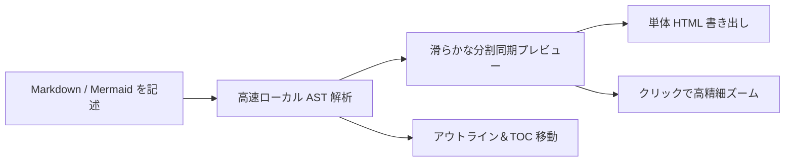

# ZMark へようこそ


> **Rust + GPUI** で構築された、高速なネイティブ・ローカル Markdown エディタ＆リーディングワークスペースです。<br/>左側のソースを編集すると、右側のプレビューがブロック単位の滑らかな同期スクロールで即座に更新されます。

[toc]

---

## 1. ZMark の主な機能

1. **ファイルと下書きの管理**：`Cmd+O` でローカルの `.md` ファイルを開き、`Cmd+N` で下書きを作成。**Markdown ファイル、フォルダ、ローカル画像のドラッグ＆ドロップ**にも対応しています。
2. **3つの表示モードと同期スクロール**：`Cmd+1`（ソース）、`Cmd+2`（左右分割）、`Cmd+3`（プレビュー）を瞬時に切り替え。分割時はブロック単位で滑らかに同期します。
3. **サイドバー＆インタラクティブ目次**：`Cmd+Shift+B` でサイドバーを開閉し、`Cmd+Shift+O` で**ファイルツリー**と**見出しアウトライン**をワンキー切替。本文中の `[toc]` は上のようなクリック可能な目次カードとして描画されます。
4. **保存・名前変更・HTML 書き出し**：`Cmd+S` で保存、**ヘッダーのタイトルをダブルクリック**でリネーム、`Cmd+Shift+E` で美しい単体 HTML を書き出せます。
5. **7種類のテーマ＆カスタムショートカット**：`Cmd+,` で設定を開き、19 項目のカラーカスタマイズや **17 項目のクリック録音式ショートカット変更**を行えます。
6. **ベクター SVG ＆高精細ライトボックス**：ローカル画像や SVG イラスト、Mermaid 図をクリックすると、拡大・パン操作できるライトボックスが開きます。

---

## 2. 最近追加された機能

一つずつ試して、終わったら左のソースで `[ ]` を `[x]` に変えてみてください。

- [ ] **本文とコードのフォントを別々に設定**：`Cmd+,` で設定を開き、「外観 → フォント」で「本文フォント」と「コードフォント」を選びます。インストール済みのフォントを検索できます。本文フォントはインターフェースにも使われます。
- [ ] **読書幅をドラッグで調整**：`Cmd+3` でプレビューにし、本文の左右の端をドラッグします。端をダブルクリックすると既定の幅に戻ります。「編集と保存 → 読書幅」にもプリセットがあります。
- [ ] **サイドバーの幅を調整**：`Cmd+Shift+B` でサイドバーを開き、右端をドラッグします。ダブルクリックで既定の幅に戻ります。
- [ ] **よく使うファイルを固定**：サイドバーでファイルやフォルダを右クリックし、「トップに固定」を選ぶと、フォルダ内の先頭に表示されます。
- [ ] **ライトボックスのジェスチャー**：下にあるイラストや図をクリックし、マウスホイールかトラックパッドのピンチで拡大縮小、Mac のトラックパッドでは 2 本指でパンできます。スクロール方向はシステム設定に従います。
- [ ] **タブバーを表示**：`Cmd+,` で設定を開き、「エディタと保存」の「タブバーを表示」をオンにします。開いている文書がヘッダーのタブになり、ドラッグで並べ替え、`Ctrl+Tab` で切り替えできます。
- [ ] **プレビューで直接編集**：同じページの「プレビューで編集」をオンにして `Cmd+3` でプレビューに入り、段落・リスト・コードブロックをクリックすると、その場で Markdown ソースの編集ボックスになります。`Esc` で終了します。
- [ ] **ファイルをすばやく開く**：`Cmd+O` でファイルを選ぶか、サイドバー上部の「ファイルまたはフォルダーを開く」でファイルを選ぶか、フォルダー全体を追加します。Finder やファイルマネージャーから `.md` ファイルやフォルダーをウィンドウに**ドラッグ**しても開け、フォルダーはサイドバーに表示されます。
- [ ] **前回の続きから**：ZMark を起動すると、前回終了したときに開いていたファイルが再び開きます。Finder やファイルマネージャで `.md` ファイルをダブルクリックすると、そのファイルが直接開きます。

> **このガイドについて：** ウェルカムページを閉じると、次回からは自動で表示されません。もう一度見るには「設定 → 情報 → ウェルカムガイド」で「ガイドを復元」をクリックします。

---

## 3. よく使う Markdown 記法プレイグラウンド

### 1. 文字装飾・改行・引用・リンク

- インライン装飾：**太字**、*斜体*、~~打ち消し線~~、`インラインコード`
- HTML `<br/>` 改行：段落内の `<br/>` で強制改行、単独行の `<br/>` で心地よい余白を作れます。
- 編集と検索：`Cmd+B` で太字、`Cmd+Shift+7` で番号付きリスト切替、`Cmd+F`（`Cmd+G` / `Cmd+Shift+G`）でファイル内検索。
- リンク：[ZMark GitHub](https://github.com/2716190547/zmark) · [リリース一覧](https://github.com/2716190547/zmark/releases)

> **完全ローカル設計：** ZMark は適応幅テーブル、タスクリスト、多言語シンタックスハイライト、SVG、Mermaid 図をオフライン・ミリ秒単位で描画します。

### 2. リストとタスクリスト

- [x] ZMark を起動して「ZMark へようこそ.md」を開く
- [ ] 上の埋め込み目次カードの見出しをクリックしてジャンプを試す
- [ ] `Cmd+Shift+B` でサイドバーを開き、よく使うフォルダを追加する
- [ ] `Cmd+,` でテーマやカスタムショートカットを設定する
  - ネストされた箇条書きと自動インデントに対応
  - 左側ソースで `[ ]` を `[x]` に変えると即座に完了表示になります

### 3. 自動調整テーブルと初期ショートカット

| 機能 | 初期ショートカット（Mac / Win & Linux） | 説明 |
| --- | --- | --- |
| 開く / 新しい下書き | `Cmd+O` / `Cmd+N` | 複数ファイルと下書きを並列管理 |
| ソース / 分割 / プレビュー | `Cmd+1` / `Cmd+2` / `Cmd+3` | ブロック同期の滑らかスクロール |
| サイドバー / アウトライン切替 | `Cmd+Shift+B` / `Cmd+Shift+O` | フォルダ検索と見出しジャンプを統合 |
| ファイル内検索 | `Cmd+F`（`Cmd+G` で次へ） | 一致箇所をハイライトして素早く移動 |
| 単体 HTML 出力 | `Cmd+Shift+E` | 整形用 CSS を埋め込んだ単体 HTML として出力 |
| 設定を開く | `Cmd+,` | 配色カスタム、フォント、ショートカット変更 |

### 4. シンタックスハイライト付きコード（ワンクリックコピー）

```rust
fn main() {
    let app = "ZMark";
    let stack = ["Rust", "GPUI", "pulldown-cmark", "rusty-mermaid"];
    println!("{app} built with {stack:?}");
}
```

```json
{
  "editor": "ZMark",
  "views": ["source", "split", "preview"],
  "tocBlock": true,
  "vectorSvgLightbox": true
}
```

### 5. お試し：下のベクター画像をクリックして拡大！


<br/>

### 6. ネイティブ Mermaid 図（こちらもクリックで拡大）


