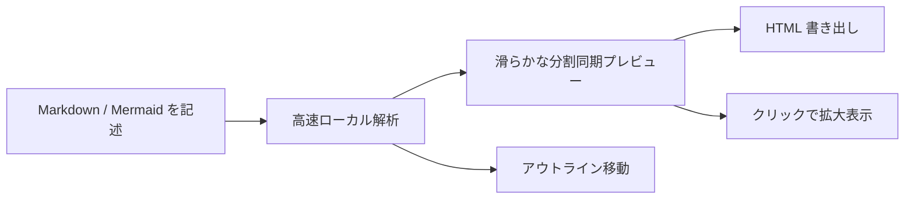

# ZMark へようこそ

> **Rust + GPUI** で構築された、高速なネイティブ・ローカル Markdown エディタ＆リーディングワークスペースです。  
> 左側のソースを編集すると、右側のプレビューが滑らかな同期スクロール付きでリアルタイムに更新されます。

---

## 1. クイックスタート：ZMark の主な機能

1. **ファイルを開く・下書きを作成する**：`Cmd+O` でローカルの `.md` ファイルを開き、`Cmd+N` で新しい下書きを作成できます。**`.md` ファイルやローカル画像をウィンドウへ直接ドラッグ＆ドロップ**することも可能です。
2. **3つの表示モードと同期スクロール**：`Cmd+1`（ソース）、`Cmd+2`（左右分割）、`Cmd+3`（プレビュー）を瞬時に切り替えられます。分割表示ではブロック単位で滑らかに同期スクロールします。
3. **フォルダワークスペースとアウトライン**：`Cmd+Shift+B` でサイドバーを開閉し、フォルダの追加やファイル検索を行えます。`Cmd+Shift+O` で**ファイルツリー**と**ドキュメントアウトライン**をワンキーで切り替えられます。
4. **保存・名前変更・HTML 書き出し**：`Cmd+S` で保存、**ヘッダーのタイトルをダブルクリック**で名前変更、`Cmd+Shift+E` で美しいスタンドアロン HTML を書き出せます。
5. **テーマ配色とカスタムショートカット**：`Cmd+,` で設定を開き、7種類のテーマ、詳細カラーカスタマイズ、**17項目のクリック録音式ショートカット変更**を利用できます。
6. **高精細ライトボックス**：プレビュー内のローカル画像や Mermaid 図をクリックすると、拡大・移動できるライトボックスが開きます。

---

## 2. よく使う Markdown 記法サンプル

以下の記法を書き換えて、リアルタイム表示をお試しください：

### 1. 文字装飾・引用・リンク

- テキスト装飾：**太字**、*斜体*、~~打ち消し線~~、`インラインコード`
- 編集ショートカット：`Cmd+B` で太字、`Cmd+Shift+7` で番号付きリストを切り替え
- ファイル内検索：`Cmd+F` で検索、`Cmd+G` / `Cmd+Shift+G` で次／前の一致へ移動
- リンク：[ZMark GitHub](https://github.com/2716190547/zmark) · [リリース一覧](https://github.com/2716190547/zmark-releases)

> ヒント：ZMark はテーブル、タスクリスト、多言語シンタックスハイライト、Mermaid 図を含む主要な Markdown 記法を完全オフライン・ミリ秒単位で描画します。

### 2. リストとタスクリスト

- [x] ZMark を起動して「ZMark へようこそ.md」を開く
- [ ] `Cmd+Shift+B` でサイドバーを開き、よく使うフォルダを追加する
- [ ] `Cmd+,` でテーマやカスタムショートカットを設定する
  - ネストされた箇条書きと自動インデントに対応
  - ソース上で `[ ]` を `[x]` に変更すると完了状態になります

### 3. 主な機能と初期ショートカット一覧

| 機能 | 初期ショートカット（Mac / Win & Linux） | 説明 |
| --- | --- | --- |
| 開く / 新しい下書き | `Cmd+O` / `Cmd+N` | 複数ファイルや下書きをすばやく切り替え |
| ソース / 分割 / プレビュー | `Cmd+1` / `Cmd+2` / `Cmd+3` | 分割時はブロック同期の滑らかスクロール |
| サイドバー / アウトライン切替 | `Cmd+Shift+B` / `Cmd+Shift+O` | フォルダ検索と見出しジャンプを統合 |
| ファイル内検索 | `Cmd+F`（`Cmd+G` で次へ） | 一致箇所をハイライトして素早く移動 |
| スタンドアロン HTML 出力 | `Cmd+Shift+E` | 整形用CSSを埋め込んだ単体HTMLとして出力 |
| 設定を開く | `Cmd+,` | 配色カスタム、フォント、ショートカット変更 |

### 4. シンタックスハイライト付きコードブロック

```rust
fn main() {
    let app = "ZMark";
    let stack = ["Rust", "GPUI", "pulldown-cmark", "rusty-mermaid"];
    println!("{app} built with {stack:?}");
}
```

```json
{
  "editor": "ZMark",
  "views": ["source", "split", "preview"],
  "customizableShortcuts": true,
  "localOnly": true
}
```

### 5. ネイティブ Mermaid 図（クリックでライトボックス拡大）


