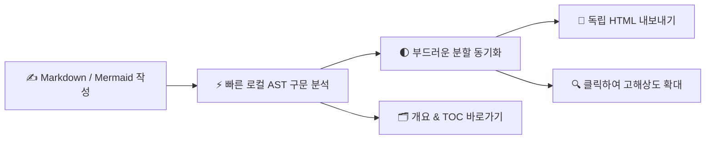

# ✨ ZMark 시작 가이드


> ⚡️ **Rust + GPUI**로 만든 빠르고 쾌적한 네이티브 로컬 Markdown 편집기 겸 읽기 워크스페이스입니다.<br/>왼쪽 소스를 수정하면 오른쪽 미리보기가 블록 단위 동기 스크롤과 함께 부드럽게 반응합니다.

[toc]

---

## 🚀 1. ZMark 핵심 기능 한눈에 보기


1. 📂 **파일 열기 및 초안 관리**: `Cmd+O`로 `.md` 파일을 열거나 `Cmd+N`으로 새 초안을 만드세요. **Markdown 파일, 폴더, 로컬 이미지를 창으로 바로 드래그 앤 드롭**할 수도 있습니다.
2. 🌓 **3가지 보기 모드**: `Cmd+1`(소스), `Cmd+2`(분할), `Cmd+3`(미리보기)로 즉시 전환하며 블록 기준 동기 스크롤을 제공합니다.
3. 🗂️ **작업공간 사이드바 & 클릭형 목차**: `Cmd+Shift+B`로 사이드바를 열고 `Cmd+Shift+O`로 **파일 트리**와 **문서 개요**를 전환합니다. 문서 안의 `[toc]`도 위와 같은 클릭 가능한 목차 카드로 렌더링됩니다.
4. 💾 **저장, 이름 변경, HTML 내보내기**: `Cmd+S`로 저장하고 **상단 제목을 더블 클릭**해 이름을 바꾸며 `Cmd+Shift+E`로 깔끔한 독립 HTML 파일을 내보냅니다.
5. 🎨 **7가지 테마 & 단축키 사용자 지정**: `Cmd+,` 설정 창에서 19개 색상 커스텀과 **클릭 녹음 방식의 17개 단축키 재설정**을 지원합니다.
6. 🖼️ **벡터 SVG & 고해상도 라이트박스**: 로컬 이미지, 내장 SVG 일러스트, Mermaid 다이어그램을 **클릭하면 라이트박스로 확대/이동**할 수 있습니다.

---

## ✍️ 2. 자주 쓰는 Markdown 문법 체험하기


### 1. 텍스트 서식, 줄바꿈, 인용문 및 링크

- 🔤 인라인 서식: **굵게**, *기울임*, ~~취소선~~, `인라인 코드`
- ⏎ HTML `<br/>` 지원: 문장 안 `<br/>` 줄바꿈은 물론 단독 행 `<br/>`로 깔끔한 여백을 넣을 수 있습니다.
- ⌨️ 편집 & 찾기: `Cmd+B` 굵게 토글, `Cmd+Shift+7` 번호 목록 토글, `Cmd+F`(`Cmd+G` / `Cmd+Shift+G`) 문서 내 찾기.
- 🔗 링크: [ZMark GitHub](https://github.com/2716190547/zmark) · [릴리스 페이지](https://github.com/2716190547/zmark-releases)

> 💡 **100% 로컬 동작:** ZMark는 자동 비율 표, 체크리스트, 다국어 코드 강조, SVG, Mermaid 다이어그램을 오프라인에서 밀리초 단위로 렌더링합니다.

### 2. ✅ 목록과 체크리스트

- [x] ZMark 실행 및 `ZMark 시작 가이드.md` 살펴보기
- [ ] 위 목차 카드의 제목을 클릭해 문서 내 점프 체험하기
- [ ] `Cmd+Shift+B`로 사이드바를 열어 자주 쓰는 폴더 추가하기
- [ ] `Cmd+,`로 테마 변경 및 나만의 단축키 녹음하기
  - 🧩 중첩 목록과 자동 들여쓰기 지원
  - ☑️ 왼쪽 소스에서 `[ ]`를 `[x]`로 바꾸면 실시간으로 완료 표시됩니다

### 3. 📋 자동 열 비율 표 & 기본 단축키

| 기능 | 기본 단축키 (Mac / Win & Linux) | 설명 |
| --- | --- | --- |
| 파일 열기 / 새 초안 | `Cmd+O` / `Cmd+N` | 작업공간 파일과 초안을 함께 관리 |
| 소스 / 분할 / 미리보기 | `Cmd+1` / `Cmd+2` / `Cmd+3` | 분할 보기에서 블록 기준 부드러운 동기 스크롤 |
| 사이드바 / 개요 전환 | `Cmd+Shift+B` / `Cmd+Shift+O` | 폴더 검색 및 제목 개요 빠른 탐색 |
| 문서 내 찾기 | `Cmd+F` (`Cmd+G` 다음) | 실시간 강조 및 빠른 이동 지원 |
| 독립 HTML 내보내기 | `Cmd+Shift+E` | 내장 스타일이 포함된 독립 HTML 파일로 저장 |
| 설정 열기 | `Cmd+,` | 색상 커스텀, 글꼴 및 단축키 재설정 |

### 4. 💻 다국어 코드 구문 강조 (클릭 한 번으로 복사)

```rust
fn main() {
    let app = "ZMark";
    let stack = ["Rust", "GPUI", "pulldown-cmark", "rusty-mermaid"];
    println!("{app} built with {stack:?}");
}
```

```json
{
  "editor": "ZMark",
  "views": ["source", "split", "preview"],
  "tocBlock": true,
  "vectorSvgLightbox": true
}
```

### 5. 🖼️ 체험하기: 아래 벡터 일러스트를 클릭해 확대해 보세요!


<br/>

### 6. 📊 네이티브 Mermaid 다이어그램 (클릭 확대 지원)


