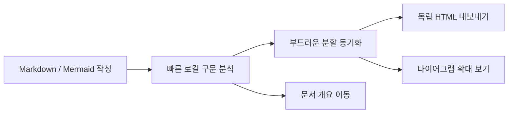

# ZMark 시작 가이드

> **Rust + GPUI** 기반으로 제작된 빠르고 가벼운 네이티브 로컬 Markdown 편집기 겸 읽기 워크스페이스입니다.  
> 왼쪽 소스 창에서 내용을 수정하면 오른쪽 미리보기가 부드러운 동기 스크롤과 함께 즉시 반영됩니다.

---

## 1. 빠른 시작: ZMark 핵심 기능

1. **파일 열기 및 초안 작성**: `Cmd+O`로 로컬 `.md` 파일을 열거나 `Cmd+N`으로 새 초안을 만드세요. **`.md` 파일이나 로컬 이미지를 창으로 끌어다 놓아** 바로 열거나 삽입할 수도 있습니다.
2. **3가지 보기 모드와 부드러운 동기 스크롤**: `Cmd+1`(소스), `Cmd+2`(분할), `Cmd+3`(미리보기)로 즉시 전환하며, 분할 모드에서는 블록 단위 정렬과 부드러운 동기 스크롤을 제공합니다.
3. **폴더 작업공간과 문서 개요**: `Cmd+Shift+B`로 사이드바를 열고 로컬 폴더를 추가해 실시간 검색을 사용할 수 있으며, `Cmd+Shift+O`로 **파일 트리**와 **문서 개요**를 한 번에 전환합니다.
4. **저장, 이름 변경, HTML 내보내기**: `Cmd+S`로 저장하고, **상단 제목을 더블 클릭**해 이름을 바꿀 수 있으며, `Cmd+Shift+E`로 깔끔한 독립 HTML 파일을 내보냅니다.
5. **테마 팔레트 및 단축키 사용자 지정**: `Cmd+,`로 설정을 열어 7가지 테마, 세부 색상 커스텀, **클릭 녹음 방식의 단축키 재설정**을 이용해 보세요.
6. **고해상도 라이트박스**: 미리보기의 로컬 이미지나 Mermaid 다이어그램을 클릭하면 확대 및 이동이 가능한 라이트박스가 열립니다.

---

## 2. 자주 쓰는 Markdown 문법 체험

아래 문법을 직접 수정하면서 실시간 렌더링 결과를 확인해 보세요:

### 1. 텍스트 스타일, 인용문 및 링크

- 서식 지원: **굵게**, *기울임*, ~~취소선~~, `인라인 코드`
- 편집 단축키: `Cmd+B` 굵게 토글, `Cmd+Shift+7` 번호 매기기 목록 토글
- 문서 내 찾기: `Cmd+F` 찾기, `Cmd+G` / `Cmd+Shift+G` 다음 또는 이전 일치 이동
- 링크: [ZMark GitHub](https://github.com/2716190547/zmark) · [릴리스 페이지](https://github.com/2716190547/zmark-releases)

> 팁: ZMark는 표, 체크리스트, 다국어 코드 강조, 로컬 이미지, Mermaid 다이어그램을 인터넷 연결 없이 로컬에서 밀리초 단위로 렌더링합니다.

### 2. 목록 및 작업 체크리스트

- [x] ZMark 실행 및 `ZMark 시작 가이드.md` 살펴보기
- [ ] `Cmd+Shift+B`로 사이드바를 열어 자주 쓰는 폴더 추가하기
- [ ] `Cmd+,`로 테마와 나만의 단축키 설정하기
  - 중첩 목록과 자동 들여쓰기 지원
  - 소스에서 `[ ]`를 `[x]`로 바꾸면 완료로 표시됩니다

### 3. 주요 기능과 기본 단축키 표

| 기능 | 기본 단축키 (Mac / Win & Linux) | 설명 |
| --- | --- | --- |
| 파일 열기 / 새 초안 | `Cmd+O` / `Cmd+N` | 작업공간 파일과 초안을 함께 관리 |
| 소스 / 분할 / 미리보기 | `Cmd+1` / `Cmd+2` / `Cmd+3` | 분할 보기에서 블록 기준 부드러운 동기 스크롤 |
| 사이드바 / 개요 전환 | `Cmd+Shift+B` / `Cmd+Shift+O` | 폴더 검색 및 제목 개요 빠른 탐색 |
| 문서 내 찾기 | `Cmd+F` (`Cmd+G` 다음) | 실시간 강조 및 빠른 이동 지원 |
| 독립 HTML 내보내기 | `Cmd+Shift+E` | 내장 스타일이 포함된 독립 HTML 파일로 저장 |
| 설정 열기 | `Cmd+,` | 색상 커스텀, 글꼴 및 단축키 재설정 |

### 4. 다국어 코드 구문 강조 (클릭 한 번으로 복사)

```rust
fn main() {
    let app = "ZMark";
    let stack = ["Rust", "GPUI", "pulldown-cmark", "rusty-mermaid"];
    println!("{app} built with {stack:?}");
}
```

```json
{
  "editor": "ZMark",
  "views": ["source", "split", "preview"],
  "customizableShortcuts": true,
  "localOnly": true
}
```

### 5. 네이티브 Mermaid 다이어그램 (클릭하여 라이트박스 확대)


