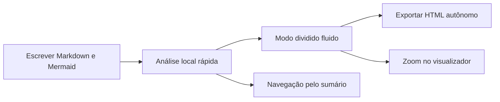

# Boas-vindas ao ZMark

> Um editor Markdown local e espaço de leitura nativo e ultrarrápido desenvolvido com **Rust + GPUI**.  
> Edite qualquer trecho à esquerda e acompanhe a prévia sincronizada em tempo real à direita.

---

## 1. Primeiros passos: o que o ZMark faz

1. **Abrir arquivos e criar rascunhos**: pressione `Cmd+O` para abrir arquivos `.md`, `Cmd+N` para criar um rascunho ou **arraste e solte arquivos Markdown e imagens locais** direto na janela.
2. **Três modos de visualização**: alterne entre **Código-fonte** (`Cmd+1`), **Dividido** (`Cmd+2`) e **Prévia** (`Cmd+3`) com rolagem sincronizada e suave por bloco.
3. **Pastas e sumário do documento**: pressione `Cmd+Shift+B` para abrir a barra lateral, adicionar pastas com busca rápida e `Cmd+Shift+O` para alternar entre **Arquivos** e **Sumário**.
4. **Salvar, renomear e exportar**: salve com `Cmd+S`, dê **duplo clique no título** para renomear na hora e use `Cmd+Shift+E` para exportar HTML independente.
5. **Temas e atalhos personalizáveis**: abra as Configurações com `Cmd+,` — 7 paletas claras/escuras, edição completa de cores e **atalhos graváveis com um clique**.
6. **Visualizador HiDPI**: clique em qualquer imagem local ou diagrama Mermaid para ampliar em tela cheia.

---

## 2. Demonstração da sintaxe Markdown

Experimente alterar os exemplos abaixo:

### 1. Formatação de texto, citações e links

- Estilos de texto: **negrito**, *itálico*, ~~tachado~~ e `código em linha`.
- Atalhos de edição: `Cmd+B` alterna negrito e `Cmd+Shift+7` alterna lista numerada.
- Busca no arquivo: `Cmd+F` abre a busca; `Cmd+G` / `Cmd+Shift+G` navega entre ocorrências.
- Links: [ZMark no GitHub](https://github.com/2716190547/zmark) · [Lançamentos](https://github.com/2716190547/zmark-releases)

> **100% local:** o ZMark renderiza tabelas, listas de tarefas, realce de sintaxe, imagens locais e diagramas Mermaid offline em milissegundos.

### 2. Listas e tarefas

- [x] Abrir o ZMark e conhecer `Boas-vindas ao ZMark.md`
- [ ] Pressionar `Cmd+Shift+B` para abrir a barra lateral e adicionar uma pasta
- [ ] Abrir `Cmd+,` para testar outra paleta ou regravar um atalho
  - Item aninhado com recuo automático
  - Troque `[ ]` por `[x]` no código-fonte para marcar a tarefa

### 3. Recursos principais e atalhos padrão

| Recurso | Atalho padrão (Mac / Win & Linux) | Descrição |
| --- | --- | --- |
| Abrir / Novo rascunho | `Cmd+O` / `Cmd+N` | Trabalhe com pastas e rascunhos ao mesmo tempo |
| Fonte / Dividido / Prévia | `Cmd+1` / `Cmd+2` / `Cmd+3` | Rolagem suave sincronizada por bloco |
| Barra lateral / Sumário | `Cmd+Shift+B` / `Cmd+Shift+O` | Árvore de pastas, filtro e títulos clicáveis |
| Localizar no documento | `Cmd+F` (`Cmd+G` próximo) | Destaque instantâneo com navegação rápida |
| Exportar HTML autônomo | `Cmd+Shift+E` | Página HTML autônoma com estilos integrados |
| Abrir Configurações | `Cmd+,` | Paletas personalizadas, fontes e atalhos |

### 4. Blocos de código com realce (e cópia rápida)

```rust
fn main() {
    let app = "ZMark";
    let stack = ["Rust", "GPUI", "pulldown-cmark", "rusty-mermaid"];
    println!("{app} built with {stack:?}");
}
```

```json
{
  "editor": "ZMark",
  "views": ["source", "split", "preview"],
  "customizableShortcuts": true,
  "localOnly": true
}
```

### 5. Diagramas Mermaid nativos (clique para ampliar)


