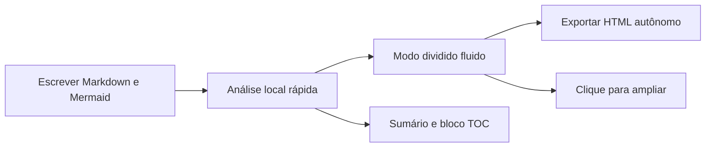

# Boas-vindas ao ZMark


> Um editor Markdown local e espaço de leitura nativo e ultrarrápido feito com **Rust + GPUI**.<br/>Edite qualquer trecho à esquerda e veja a prévia responder com rolagem sincronizada suave por bloco à direita.

[toc]

---

## 1. O que o ZMark pode fazer

1. **Arquivos locais e rascunhos**: pressione `Cmd+O` para abrir `.md`, `Cmd+N` para criar um rascunho ou **arraste e solte arquivos, pastas e imagens** direto na janela.
2. **Três modos de visualização**: alterne entre **Código-fonte** (`Cmd+1`), **Dividido** (`Cmd+2`) e **Prévia** (`Cmd+3`) com rolagem suave sincronizada.
3. **Barra lateral e sumário clicável `[toc]`**: `Cmd+Shift+B` abre pastas com filtro rápido e `Cmd+Shift+O` alterna para o **Sumário**; o marcador `[toc]` também renderiza um índice clicável no documento.
4. **Salvar, renomear e exportar HTML**: `Cmd+S` salva, **duplo clique no título** renomeia na hora e `Cmd+Shift+E` exporta HTML autônomo.
5. **7 paletas e atalhos personalizáveis**: pressione `Cmd+,` para ajustar 19 cores e **regravar qualquer um dos 17 atalhos com um clique**.
6. **SVG vetorial e visualizador HiDPI**: clique em imagens locais, ilustrações SVG ou diagramas Mermaid para ampliar com zoom e arraste.

---

## 2. Demonstração interativa da sintaxe Markdown

### 1. Formatação, quebras `<br/>`, citações e links

- Formatação em linha: **negrito**, *itálico*, ~~tachado~~ e `código em linha`.
- HTML `<br/>`: use `<br/>` no meio do texto para quebrar linha ou isolado em uma linha para dar espaçamento extra.
- Atalhos e busca: `Cmd+B` para negrito, `Cmd+Shift+7` para lista numerada, `Cmd+F` (`Cmd+G` / `Cmd+Shift+G`) para localizar.
- Links: [ZMark no GitHub](https://github.com/2716190547/zmark) · [Lançamentos](https://github.com/2716190547/zmark/releases)

> **100% local:** o ZMark renderiza tabelas adaptativas, listas de tarefas, realce de código, SVGs e Mermaid offline em milissegundos.

### 2. Listas e tarefas interativas

- [x] Abrir o ZMark e conhecer `Boas-vindas ao ZMark.md`
- [ ] Clicar em um título no bloco `[toc]` acima para navegar
- [ ] Pressionar `Cmd+Shift+B` para abrir a barra lateral e adicionar uma pasta
- [ ] Abrir `Cmd+,` para testar outra paleta ou regravar seus atalhos
  - Itens aninhados com recuo automático
  - Troque `[ ]` por `[x]` à esquerda para marcar a tarefa ao vivo

### 3. Tabelas adaptativas e atalhos padrão

| Recurso | Atalho padrão (Mac / Win & Linux) | Descrição |
| --- | --- | --- |
| Abrir / Novo rascunho | `Cmd+O` / `Cmd+N` | Trabalhe com pastas e rascunhos ao mesmo tempo |
| Fonte / Dividido / Prévia | `Cmd+1` / `Cmd+2` / `Cmd+3` | Rolagem suave sincronizada por bloco |
| Barra lateral / Sumário | `Cmd+Shift+B` / `Cmd+Shift+O` | Árvore de pastas, filtro e títulos clicáveis |
| Localizar no documento | `Cmd+F` (`Cmd+G` próximo) | Destaque instantâneo com navegação rápida |
| Exportar HTML autônomo | `Cmd+Shift+E` | Página HTML autônoma com estilos integrados |
| Abrir Configurações | `Cmd+,` | Paletas personalizadas, fontes e atalhos |

### 4. Blocos de código com realce (e cópia rápida)

```rust
fn main() {
    let app = "ZMark";
    let stack = ["Rust", "GPUI", "pulldown-cmark", "rusty-mermaid"];
    println!("{app} built with {stack:?}");
}
```

```json
{
  "editor": "ZMark",
  "views": ["source", "split", "preview"],
  "tocBlock": true,
  "vectorSvgLightbox": true
}
```

### 5. Experimente: clique no cartão vetorial abaixo para ampliar!


<br/>

### 6. Diagramas Mermaid nativos (clique também para ampliar)


