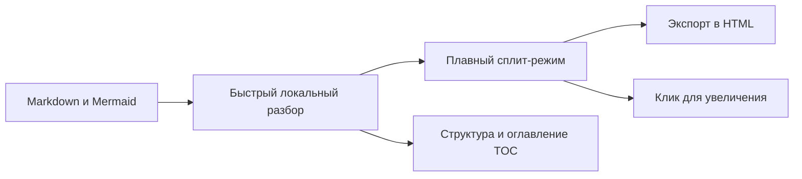

# Добро пожаловать в ZMark


> Быстрый нативный локальный Markdown-редактор и пространство для чтения на базе **Rust + GPUI**.<br/>Редактируйте Markdown слева и наблюдайте плавную синхронную прокрутку в предпросмотре справа.

[toc]

---

## 1. Ключевые возможности ZMark

1. **Локальные файлы и черновики**: `Cmd+O` открывает `.md`, `Cmd+N` создаёт черновик, также можно **перетащить файлы, папки и картинки** прямо в окно.
2. **Три режима просмотра**: мгновенное переключение **Исходник** (`Cmd+1`), **Разделение** (`Cmd+2`) и **Предпросмотр** (`Cmd+3`) с плавной синхронизацией по блокам.
3. **Боковая панель и живое оглавление `[toc]`**: `Cmd+Shift+B` открывает папки, `Cmd+Shift+O` переключает на **Структуру**; а тег `[toc]` строит компактное кликабельное оглавление прямо в документе.
4. **Сохранение, переименование и экспорт**: `Cmd+S` сохраняет файл, **двойной клик по заголовку** переименовывает его на месте, а `Cmd+Shift+E` экспортирует автономный HTML.
5. **7 палитр и настраиваемые клавиши**: `Cmd+,` открывает настройки с 19 цветами и **17 комбинациями клавиш, переназначаемыми в один клик**.
6. **Векторный SVG и HiDPI-лайтбокс**: нажмите на локальное изображение, встроенный SVG или диаграмму Mermaid, чтобы масштабировать их в лайтбоксе.

---

## 2. Живые примеры синтаксиса Markdown

### 1. Стили текста, переносы `<br/>`, цитаты и ссылки

- Оформление: **жирный**, *курсив*, ~~зачёркнутый~~ и `встроенный код`.
- HTML `<br/>`: используйте `<br/>` внутри абзаца для переноса строки или отдельной строкой для воздушного отступа.
- Клавиши и поиск: `Cmd+B` (жирный), `Cmd+Shift+7` (нумерованный список), `Cmd+F` (`Cmd+G` / `Cmd+Shift+G`).
- Ссылки: [ZMark на GitHub](https://github.com/2716190547/zmark) · [Релизы](https://github.com/2716190547/zmark-releases)

> **100% локально:** ZMark обрабатывает адаптивные таблицы, списки задач, подсветку кода, SVG и диаграммы Mermaid на устройстве за миллисекунды.

### 2. Списки и интерактивные задачи

- [x] Запустить ZMark и открыть `Добро пожаловать в ZMark.md`
- [ ] Нажать на любой пункт в блоке `[toc]` выше для быстрого перехода
- [ ] Нажать `Cmd+Shift+B` и добавить рабочую папку
- [ ] Открыть `Cmd+,`, чтобы сменить палитру или записать свои горячие клавиши
  - Вложенные пункты с автоматическим отступом
  - Замените `[ ]` на `[x]` слева — галочка обновится мгновенно

### 3. Адаптивные таблицы и клавиши по умолчанию

| Возможность | Клавиши (Mac / Win & Linux) | Описание |
| --- | --- | --- |
| Открыть / Новый черновик | `Cmd+O` / `Cmd+N` | Параллельная работа с папками и заметками |
| Исходник / Разделение / Предпросмотр | `Cmd+1` / `Cmd+2` / `Cmd+3` | Плавная поблочная синхронизация прокрутки |
| Боковая панель / Структура | `Cmd+Shift+B` / `Cmd+Shift+O` | Дерево папок, поиск и навигация по заголовкам |
| Поиск по тексту | `Cmd+F` (`Cmd+G` далее) | Мгновенный счётчик совпадений и переход |
| Экспорт автономного HTML | `Cmd+Shift+E` | Автономный HTML со встроенными стилями оформления |
| Настройки | `Cmd+,` | Свои цвета, типографика и редактор клавиш |

### 4. Подсветка кода (с копированием в один клик)

```rust
fn main() {
    let app = "ZMark";
    let stack = ["Rust", "GPUI", "pulldown-cmark", "rusty-mermaid"];
    println!("{app} built with {stack:?}");
}
```

```json
{
  "editor": "ZMark",
  "views": ["source", "split", "preview"],
  "tocBlock": true,
  "vectorSvgLightbox": true
}
```

### 5. Попробуйте: нажмите на векторную открытку для увеличения!


<br/>

### 6. Нативные диаграммы Mermaid (также увеличиваются по клику)


