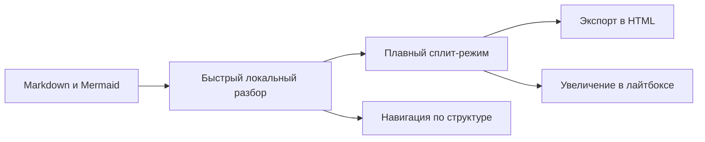

# Добро пожаловать в ZMark

> Быстрый нативный локальный Markdown-редактор и рабочее пространство для чтения на базе **Rust + GPUI**.  
> Измените текст слева — и увидите мгновенный отклик предпросмотра с плавной синхронной прокруткой справа.

---

## 1. Быстрый старт: возможности ZMark

1. **Открытие файлов и черновики**: нажмите `Cmd+O` для открытия локального `.md`, `Cmd+N` для нового черновика или просто **перетащите `.md` файлы и локальные изображения** прямо в окно.
2. **Три режима просмотра**: мгновенное переключение между **Исходником** (`Cmd+1`), **Разделением** (`Cmd+2`) и **Предпросмотром** (`Cmd+3`) с плавной синхронизацией по блокам.
3. **Папки и структура документа**: нажмите `Cmd+Shift+B`, чтобы открыть боковую панель и подключить папки с поиском; `Cmd+Shift+O` переключает **Файлы** и **Структуру** для перехода к любому заголовку.
4. **Сохранение, переименование и экспорт**: `Cmd+S` сохраняет файл, **двойной клик по заголовку** переименовывает его на месте, а `Cmd+Shift+E` экспортирует автономный HTML.
5. **Темы и настраиваемые клавиши**: нажмите `Cmd+,`, чтобы выбрать из 7 палитр, настроить свои цвета и **переназначить любую комбинацию клавиш кликом**.
6. **HiDPI-лайтбокс**: нажмите на локальное изображение или диаграмму Mermaid, чтобы рассмотреть детали в масштабе.

---

## 2. Примеры поддерживаемого синтаксиса Markdown

Попробуйте отредактировать блоки ниже:

### 1. Стили текста, цитаты и ссылки

- Оформление текста: **жирный**, *курсив*, ~~зачёркнутый~~ и `встроенный код`.
- Быстрое форматирование: `Cmd+B` — жирный текст, `Cmd+Shift+7` — нумерованный список.
- Поиск в документе: `Cmd+F` открывает поиск, `Cmd+G` / `Cmd+Shift+G` переходит по совпадениям.
- Ссылки: [ZMark на GitHub](https://github.com/2716190547/zmark) · [Релизы](https://github.com/2716190547/zmark-releases)

> **Полностью локально:** ZMark обрабатывает таблицы, списки задач, подсветку синтаксиса, локальные изображения и диаграммы Mermaid на вашем устройстве за миллисекунды.

### 2. Списки и задачи

- [x] Запустить ZMark и открыть `Добро пожаловать в ZMark.md`
- [ ] Нажать `Cmd+Shift+B` и добавить рабочую папку
- [ ] Открыть `Cmd+,` и настроить палитру или горячие клавиши
  - Вложенный пункт с автоматическим отступом
  - Замените `[ ]` на `[x]` в исходнике, чтобы отметить выполнение

### 3. Основные команды и клавиши по умолчанию

| Возможность | Клавиши (Mac / Win & Linux) | Описание |
| --- | --- | --- |
| Открыть / Новый черновик | `Cmd+O` / `Cmd+N` | Параллельная работа с папками и заметками |
| Исходник / Разделение / Предпросмотр | `Cmd+1` / `Cmd+2` / `Cmd+3` | Плавная поблочная синхронизация прокрутки |
| Боковая панель / Структура | `Cmd+Shift+B` / `Cmd+Shift+O` | Дерево папок, поиск и навигация по заголовкам |
| Поиск по тексту | `Cmd+F` (`Cmd+G` далее) | Мгновенный счётчик совпадений и переход |
| Экспорт автономного HTML | `Cmd+Shift+E` | Автономный HTML со встроенными стилями оформления |
| Настройки | `Cmd+,` | Свои цвета, типографика и редактор клавиш |

### 4. Подсветка кода (с копированием в один клик)

```rust
fn main() {
    let app = "ZMark";
    let stack = ["Rust", "GPUI", "pulldown-cmark", "rusty-mermaid"];
    println!("{app} built with {stack:?}");
}
```

```json
{
  "editor": "ZMark",
  "views": ["source", "split", "preview"],
  "customizableShortcuts": true,
  "localOnly": true
}
```

### 5. Нативные диаграммы Mermaid (нажмите для увеличения)


