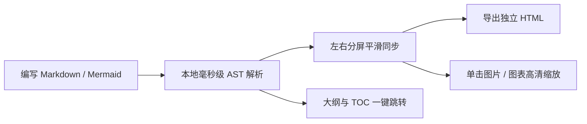

# 欢迎使用 ZMark


> 一款基于 **Rust + GPUI** 构建的原生极速本地 Markdown 编辑器与阅读工作台。<br/>直接修改左侧任意 Markdown 文本，即可在右侧体验**块级对齐、平滑同步滚动**与实时排版预览。

[toc]

---

## 一、ZMark 核心能力速览

1. **打开文件与多草稿管理**：按 `Cmd+O` 打开本地 `.md` 文件，按 `Cmd+N` 新建草稿，也可以直接**拖拽 Markdown 文件、文件夹或本地图片**到窗口中。
2. **三种写作与阅读模式**：按 `Cmd+1`（专注源码）、`Cmd+2`（左右分屏）、`Cmd+3`（纯净预览）瞬间切换；分屏模式依语法块精确同步滚动。
3. **侧栏工作区与大纲互切**：按 `Cmd+Shift+B` 展开/收起侧栏并实时模糊搜索；按 `Cmd+Shift+O` 在**文件夹**与**文章大纲**间快速切换，正文中写 `[toc]` 也会渲染成上方那样的可点击目录卡片。
4. **保存、重命名与独立导出**：按 `Cmd+S` 保存文档，**双击顶部标题**原地重命名；按 `Cmd+Shift+E` 一键导出带干净排版样式的独立 HTML 页面。
5. **7 套调色板与自定义快捷键**：按 `Cmd+,` 打开设置，支持明暗自适应、19 项全配色定制，以及 **17 项点击即可录制的自定义快捷键**。
6. **矢量 SVG 与高清灯箱缩放**：Markdown 中的本地位图、矢量 SVG 插画以及 Mermaid 图表，**单击即可进入高清灯箱视图**，自由缩放平移查看细节。

---

## 二、常用 Markdown 语法实战演练

### 1. 文字修饰、换行、引用与链接

- 常用行内修饰：**粗体文字**、*斜体文字*、~~删除线~~、以及 `行内代码`。
- HTML 轻量换行：支持段内 `<br/>` 强制换行，也支持独立成行的 `<br/>` 留白间距。
- 快捷排版与查找：`Cmd+B` 快速加粗选中文字，`Cmd+Shift+7` 快速切换有序列表；`Cmd+F` 查找、`Cmd+G` / `Cmd+Shift+G` 跳转上下匹配项。
- 项目主页：[ZMark GitHub 仓库](https://github.com/2716190547/zmark) · [版本发布页](https://github.com/2716190547/zmark-releases)

> **小贴士：** ZMark 100% 在本机运行、无需联网，原生解析 GFM 表格、任务清单、多语言代码块与 Mermaid 流程图。

### 2. 列表与交互任务清单

- [x] 启动 ZMark 并打开「欢迎使用 ZMark.md」
- [ ] 点击上方可跳转目录卡片里的任意小节标题体验跳转
- [ ] 按 `Cmd+Shift+B` 展开侧栏，添加一个常用本地文件夹
- [ ] 按 `Cmd+,` 打开设置，体验明暗主题或重新录制你的专属快捷键
  - 支持多层嵌套缩进与自动序号续排
  - 在左侧源码把 `[ ]` 改为 `[x]`，右侧列表会实时打勾完成

### 3. 自适应表格与默认快捷键表

| 模块 | 默认快捷键（Mac / Win & Linux） | 说明 |
| --- | --- | --- |
| 打开 / 新建草稿 | `Cmd+O` / `Cmd+N` | 并排管理工作区文档与临时草稿 |
| 源码 / 分屏 / 预览 | `Cmd+1` / `Cmd+2` / `Cmd+3` | 分屏下按语法块精准同步滚动 |
| 展开侧栏 / 切换大纲 | `Cmd+Shift+B` / `Cmd+Shift+O` | 文件夹树与标题大纲一键互切 |
| 文档内查找 | `Cmd+F`（`Cmd+G` 下一处） | 实时匹配计数与高亮跳转 |
| 导出独立 HTML | `Cmd+Shift+E` | 内嵌干净排版样式的独立 HTML |
| 打开设置面板 | `Cmd+,` | 主题调色板、字体排印与快捷键自定义 |

### 4. 多语言代码高亮（右上角一键复制）

```rust
fn main() {
    let app = "ZMark";
    let stack = ["Rust", "GPUI", "pulldown-cmark", "rusty-mermaid"];
    println!("{app} powered by {stack:?}");
}
```

```json
{
  "editor": "ZMark",
  "views": ["source", "split", "preview"],
  "tocBlock": true,
  "vectorSvgLightbox": true
}
```

### 5. 试一试：点击下方矢量 SVG 进入高清灯箱！


<br/>

### 6. 原生 Mermaid 流程图（同样支持单击放大）


