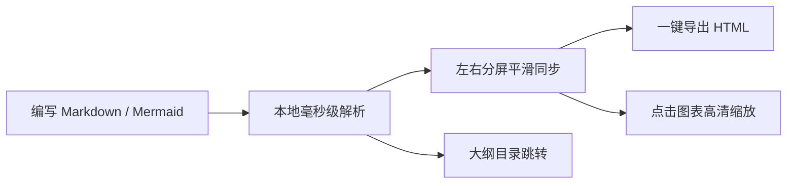

# 欢迎使用 ZMark

> 一款基于 **Rust + GPUI** 构建的原生极速本地 Markdown 编辑器与阅读工作台。  
> 点击左侧栏可管理本地文件夹，或在当前分屏视图中直接修改下文内容，体验**所写即所得**的平滑同步滚动与原生排版。

---

## 一、快速上手：ZMark 核心能力

1. **打开文件或创建草稿**：按 `Cmd+O` 打开本地 `.md` 文件，按 `Cmd+N` 新建草稿，也可以直接**拖拽 Markdown 文件或本地图片**到窗口中打开或插入。
2. **三种阅读与写作视图**：按 `Cmd+1`（专注源码）、`Cmd+2`（左右分屏）、`Cmd+3`（纯净预览）瞬间切换；分屏模式下按语法块精准对齐并支持平滑同步滚动。
3. **文件夹工作区与大纲**：按 `Cmd+Shift+B` 展开/收起侧栏，添加本地文件夹并实时模糊搜索；按 `Cmd+Shift+O` 在**文件夹**与**文档大纲**间快速切换，点击标题即刻跳转。
4. **保存、重命名与导出**：按 `Cmd+S` 保存文档（草稿会询问保存路径），**双击顶部标题**即可原地重命名；按 `Cmd+Shift+E` 导出干净的独立 HTML 文件。
5. **主题与自定义快捷键**：按 `Cmd+,` 打开设置，支持 7 套明暗主题、全配色自定义与 **17 项可点击重录快捷键**。
6. **高清灯箱与本地图片**：Markdown 中的本地图片或下方 Mermaid 流程图，**单击即可进入高清灯箱缩放视图**，支持滚轮缩放与拖拽查看细节。

---

## 二、常用 Markdown 语法速览与实时试写

你可以直接在左侧编辑区改动任意语法，观察右侧实时渲染效果：

### 1. 文本样式、引用与链接

- 文字装饰支持：**粗体文字**、*斜体文字*、~~删除线~~ 以及 `行内代码`。
- 快捷排版键：`Cmd+B` 快速加粗选中文字，`Cmd+Shift+7` 快速切换有序列表。
- 常用查找：`Cmd+F` 在当前文档内查找，`Cmd+G` / `Cmd+Shift+G` 跳转下一处或上一处。
- 项目主页：[ZMark GitHub 仓库](https://github.com/2716190547/zmark) · [版本发布页](https://github.com/2716190547/zmark-releases)

> 提示：ZMark 原生支持常见 GFM（GitHub Flavored Markdown）语法，包括任务清单、对齐表格、多语言代码高亮以及 Mermaid 图表，且无需联网、完全在本地毫秒级渲染。

### 2. 列表与任务清单

- [x] 启动 ZMark 并打开「欢迎使用 ZMark.md」
- [ ] 按 `Cmd+Shift+B` 展开侧栏，添加一个常用文件夹
- [ ] 按 `Cmd+,` 打开设置 → 主题配色或自定义快捷键
  - 嵌套子项：支持任意层级缩进与自动编号
  - 任务状态：在源码中将 `[ ]` 改为 `[x]` 即可勾选完成

### 3. 核心功能与默认快捷键表

| 功能模块 | 默认快捷键（Mac / Win & Linux） | 说明 |
| --- | --- | --- |
| 打开 / 新建草稿 | `Cmd+O` / `Cmd+N` | 支持同时维护多个草稿与工作区文件 |
| 源码 / 分屏 / 预览 | `Cmd+1` / `Cmd+2` / `Cmd+3` | 分屏支持按块对齐与平滑同步滚动 |
| 展开侧栏 / 切换大纲 | `Cmd+Shift+B` / `Cmd+Shift+O` | 文件夹树与标题大纲一键互切 |
| 文档内查找 | `Cmd+F`（`Cmd+G` 下一处） | 支持实时匹配计数与高亮跳转 |
| 导出独立 HTML | `Cmd+Shift+E` | 内嵌干净排版样式的独立 HTML 页面 |
| 打开设置面板 | `Cmd+,` | 主题调色板、字体排印与快捷键自定义 |

### 4. 多语言代码块高亮（右上角支持一键复制）

```rust
fn main() {
    let app = "ZMark";
    let stack = ["Rust", "GPUI", "pulldown-cmark", "rusty-mermaid"];
    println!("{app} powered by {stack:?}");
}
```

```json
{
  "editor": "ZMark",
  "views": ["source", "split", "preview"],
  "customizableShortcuts": true,
  "localOnly": true
}
```

### 5. 原生 Mermaid 流程图（点击下方图表可放大预览）


