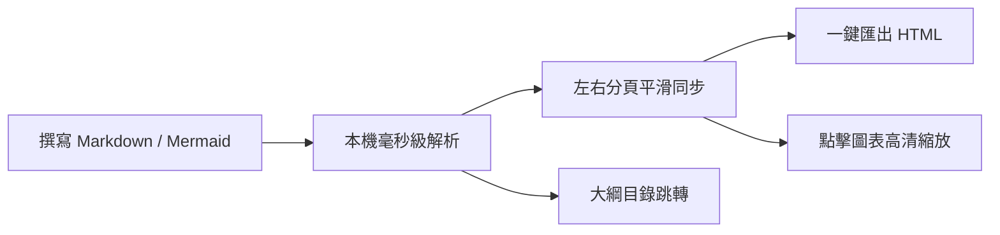

# 歡迎使用 ZMark

> 一款基於 **Rust + GPUI** 打造的原生極速本機 Markdown 編輯器與閱讀工作台。  
> 點擊左側欄可管理本機資料夾，或在目前分頁檢視中直接修改下方內容，體驗**所寫即所得**的平滑同步捲動與原生排版。

---

## 一、快速上手：ZMark 核心能力

1. **開啟檔案或新增草稿**：按 `Cmd+O` 開啟本機 `.md` 檔案，按 `Cmd+N` 新增草稿，也可以直接**拖曳 Markdown 檔案或本機圖片**至視窗開啟或插入。
2. **三種閱讀與寫作檢視**：按 `Cmd+1`（專注原始碼）、`Cmd+2`（左右分頁）、`Cmd+3`（純淨預覽）瞬間切換；分頁模式下依語法區塊精準對齊並支援平滑同步捲動。
3. **資料夾工作區與大綱**：按 `Cmd+Shift+B` 展開／收起側欄，加入本機資料夾並即時模糊搜尋；按 `Cmd+Shift+O` 在**資料夾**與**文件大綱**間快速切換，點擊標題即刻跳轉。
4. **儲存、重新命名與匯出**：按 `Cmd+S` 儲存文件（草稿會詢問儲存位置），**按兩下頂部標題**即可原地重新命名；按 `Cmd+Shift+E` 匯出乾淨的獨立 HTML 檔案。
5. **主題與自訂快速鍵**：按 `Cmd+,` 開啟設定，支援 7 套明暗主題、全配色自訂與 **17 項可點擊重新錄製的快速鍵**。
6. **高清燈箱與本機圖片**：Markdown 中的本機圖片或下方 Mermaid 流程圖，**按一下即可進入高清燈箱縮放檢視**，支援滾輪縮放與拖曳檢視細節。

---

## 二、常用 Markdown 語法速覽與即時試寫

你可以直接在左側編輯區改動任意語法，觀察右側即時算繪效果：

### 1. 文字樣式、引用與連結

- 文字裝飾支援：**粗體文字**、*斜體文字*、~~刪除線~~ 以及 `行內程式碼`。
- 快速排版鍵：`Cmd+B` 快速粗體選取文字，`Cmd+Shift+7` 快速切換有序清單。
- 常用尋找：`Cmd+F` 在目前文件內尋找，`Cmd+G`／`Cmd+Shift+G` 跳轉下一處或上一處。
- 專案主頁：[ZMark GitHub 儲存庫](https://github.com/2716190547/zmark) · [版本發佈頁](https://github.com/2716190547/zmark-releases)

> 提示：ZMark 原生支援常見 GFM（GitHub Flavored Markdown）語法，包括任務清單、表格、多語言程式碼高亮以及 Mermaid 圖表，且無需連網、完全在本機毫秒級算繪。

### 2. 清單與任務清單

- [x] 啟動 ZMark 並開啟「歡迎使用 ZMark.md」
- [ ] 按 `Cmd+Shift+B` 展開側欄，加入一個常用資料夾
- [ ] 按 `Cmd+,` 開啟設定 → 主題配色或自訂快速鍵
  - 巢狀子項：支援任意層級縮排與自動編號
  - 任務狀態：在原始碼中將 `[ ]` 改為 `[x]` 即可勾選完成

### 3. 核心功能與預設快速鍵表

| 功能模組 | 預設快速鍵（Mac / Win & Linux） | 說明 |
| --- | --- | --- |
| 開啟 / 新增草稿 | `Cmd+O` / `Cmd+N` | 支援同時管理多個草稿與工作區檔案 |
| 原始碼 / 分頁 / 預覽 | `Cmd+1` / `Cmd+2` / `Cmd+3` | 分頁支援依區塊對齊與平滑同步捲動 |
| 展開側欄 / 切換大綱 | `Cmd+Shift+B` / `Cmd+Shift+O` | 資料夾樹與標題大綱一鍵切換 |
| 文件內尋找 | `Cmd+F`（`Cmd+G` 下一處） | 支援即時符合計數與高亮跳轉 |
| 匯出獨立 HTML | `Cmd+Shift+E` | 內嵌乾淨排版樣式的獨立 HTML 頁面 |
| 開啟設定面板 | `Cmd+,` | 主題調色盤、字體排版與快速鍵自訂 |

### 4. 多語言程式碼高亮（右上角支援一鍵複製）

```rust
fn main() {
    let app = "ZMark";
    let stack = ["Rust", "GPUI", "pulldown-cmark", "rusty-mermaid"];
    println!("{app} powered by {stack:?}");
}
```

```json
{
  "editor": "ZMark",
  "views": ["source", "split", "preview"],
  "customizableShortcuts": true,
  "localOnly": true
}
```

### 5. 原生 Mermaid 流程圖（點擊下方圖表可放大預覽）


