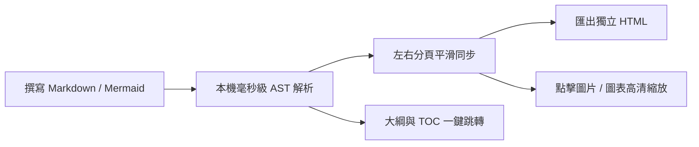

# 歡迎使用 ZMark


> 一款基於 **Rust + GPUI** 打造的原生極速本機 Markdown 編輯器與閱讀工作台。<br/>直接修改左側任意 Markdown 內容，即可在右側體驗**依語法區塊對齊、平滑同步捲動**與即時排版預覽。

[toc]

---

## 一、ZMark 核心能力速覽

1. **開啟檔案與多草稿管理**：按 `Cmd+O` 開啟本機 `.md` 檔案，按 `Cmd+N` 新增草稿，也可直接**拖曳 Markdown 檔案、資料夾或本機圖片**至視窗中。
2. **三種寫作與閱讀模式**：按 `Cmd+1`（專注原始碼）、`Cmd+2`（左右分頁）、`Cmd+3`（純淨預覽）瞬間切換；分頁模式支援依語法區塊精準同步捲動。
3. **側欄工作區與大綱互切**：按 `Cmd+Shift+B` 展開／收起側欄並即時模糊搜尋；按 `Cmd+Shift+O` 在**資料夾**與**文章大綱**間快速切換，正文中的 `[toc]` 也會算繪成上方可點擊的目錄卡片。
4. **儲存、重新命名與獨立匯出**：按 `Cmd+S` 儲存文件，**按兩下頂部標題**即可原地重新命名；按 `Cmd+Shift+E` 一鍵匯出乾淨排版樣式的獨立 HTML。
5. **7 套調色盤與自訂快速鍵**：按 `Cmd+,` 開啟設定，支援明暗自適應、19 項全配色自訂，以及 **17 項點擊即可錄製的自訂快速鍵**。
6. **向量 SVG 與高清燈箱縮放**：Markdown 中的本機點陣圖、向量 SVG 插畫及 Mermaid 圖表，**按一下即可進入高清燈箱檢視**，自由縮放拖曳細節。

---

## 二、最近新增的功能

逐項試一遍，完成後在左側原始碼裡把 `[ ]` 改成 `[x]`：

- [ ] **分別設定內文與程式碼字型**：按 `Cmd+,` 開啟設定，在「外觀模式 → 字型」裡選擇「內文字型」和「程式碼字型」，下拉選單可以搜尋已安裝的字型。內文字型同時用於介面。
- [ ] **拖曳調整閱讀寬度**：按 `Cmd+3` 進入預覽，把滑鼠移到內文欄左右邊緣拖曳，按兩下恢復預設寬度。也可以在「編輯與儲存 → 閱讀寬度」裡選預設值。
- [ ] **調整側欄寬度**：按 `Cmd+Shift+B` 展開側欄，拖曳側欄右邊緣，按兩下恢復預設寬度。
- [ ] **置頂常用檔案**：在側欄裡右鍵點按檔案或資料夾，選擇「置頂」，它會排到所在資料夾的最前面。
- [ ] **燈箱手勢**：按一下下文的插圖或流程圖，用滾輪或觸控板捏合縮放，在 Mac 觸控板上雙指拖曳平移。捲動方向跟隨系統設定。
- [ ] **開啟標籤列**：按 `Cmd+,` 開啟設定，在「編輯與儲存」中開啟「顯示標籤列」。已開啟的文件會變成頂部的標籤，拖曳可排序，`Ctrl+Tab` 循環切換。
- [ ] **在預覽中直接編輯**：在同一頁開啟「預覽中點擊編輯」，然後按 `Cmd+3` 進入預覽，點一下段落、清單或程式碼區塊，它會就地變成原始碼編輯框，按 `Esc` 離開。
- [ ] **快速開啟檔案**：按 `Cmd+O` 選擇檔案；點側欄頂部的「開啟檔案或資料夾」，可以選檔案，也可以把整個資料夾加到側欄。還可以直接把 `.md` 檔案或資料夾從 Finder 或檔案管理員**拖進視窗**，資料夾會出現在側欄裡。
- [ ] **接續上次的工作**：直接啟動 ZMark 會重新開啟上次結束時的檔案。在 Finder 或檔案管理器中按兩下 `.md` 檔案，會直接開啟該檔案。

> **關於這篇引導：** 關閉歡迎頁後，之後啟動不會再自動出現。想再看時，開啟「設定 → 關於 → 歡迎引導」，點按「恢復引導頁」。

---

## 三、常用 Markdown 語法實戰演練

### 1. 文字裝飾、換行、引用與連結

- 常用行內樣式：**粗體文字**、*斜體文字*、~~刪除線~~ 以及 `行內程式碼`。
- HTML 輕量換行：支援段內 `<br/>` 強制換行，也支援獨立成行的 `<br/>` 留白間距。
- 快速排版與尋找：`Cmd+B` 快速粗體選取文字，`Cmd+Shift+7` 切換有序清單；`Cmd+F` 尋找、`Cmd+G`／`Cmd+Shift+G` 跳轉上下符合項目。
- 專案主頁：[ZMark GitHub 儲存庫](https://github.com/2716190547/zmark) · [版本發佈頁](https://github.com/2716190547/zmark/releases)

> **小提示：** ZMark 100% 於本機運作、無需連網，原生解析 GFM 表格、任務清單、多語言程式碼高亮與 Mermaid 流程圖。

### 2. 清單與互動任務清單

- [x] 啟動 ZMark 並開啟「歡迎使用 ZMark.md」
- [ ] 點擊上方可跳轉目錄卡片中的任意標題體驗導覽
- [ ] 按 `Cmd+Shift+B` 展開側欄，加入一個常用資料夾
- [ ] 按 `Cmd+,` 開啟設定，體驗明暗主題或重新錄製專屬快速鍵
  - 支援多層巢狀縮排與自動編號續排
  - 在左側原始碼將 `[ ]` 改為 `[x]`，右側清單會即時勾選完成

### 3. 自適應表格與預設快速鍵表

| 模組 | 預設快速鍵（Mac / Win & Linux） | 說明 |
| --- | --- | --- |
| 開啟 / 新增草稿 | `Cmd+O` / `Cmd+N` | 並排管理工作區檔案與暫存草稿 |
| 原始碼 / 分頁 / 預覽 | `Cmd+1` / `Cmd+2` / `Cmd+3` | 分頁模式下依語法區塊精準同步捲動 |
| 展開側欄 / 切換大綱 | `Cmd+Shift+B` / `Cmd+Shift+O` | 資料夾樹與標題大綱一鍵切換 |
| 文件內尋找 | `Cmd+F`（`Cmd+G` 下一處） | 即時符合計數與高亮跳轉 |
| 匯出獨立 HTML | `Cmd+Shift+E` | 內嵌乾淨排版樣式的獨立 HTML |
| 開啟設定面板 | `Cmd+,` | 主題調色盤、字體排版與快速鍵自訂 |

### 4. 多語言程式碼高亮（右上角支援一鍵複製）

```rust
fn main() {
    let app = "ZMark";
    let stack = ["Rust", "GPUI", "pulldown-cmark", "rusty-mermaid"];
    println!("{app} powered by {stack:?}");
}
```

```json
{
  "editor": "ZMark",
  "views": ["source", "split", "preview"],
  "tocBlock": true,
  "vectorSvgLightbox": true
}
```

### 5. 試試看：點擊下方向量 SVG 進入高清燈箱！


<br/>

### 6. 原生 Mermaid 流程圖（同樣支援點擊放大）


