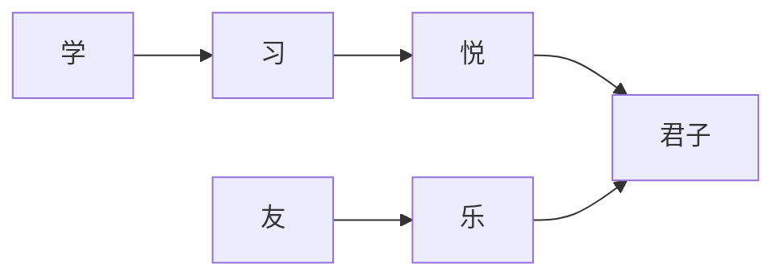

# ZMark 第四期《一秒，变排版》SPEC

修订：r1，2026-11-24。状态：已确认，进入制作。审查：自查（非独立审查）；用户于 2026-11-24 确认共识并明确跳过独立审查（用户覆盖，不是审查通过）。

## 1. 已定决策

| # | 决策 | 来源 |
| --- | --- | --- |
| D1 | 完全重新设计，不复用 v3；v3 保留并标注弃用 | 用户 Q1、Q4 |
| D2 | 横屏 16:9，工作画布 1280×720 以 2× 渲染为 2560×1440，另缩出 1920×1080，60 fps（原为竖屏 1080×1920，用户 2026-11-25 改回横屏） | 用户 Q2、2026-11-25 |
| D3 | 产品画面用 ZMark 0.2.13 真实录屏；录屏权限已授予 Herdr Core（测试截图 3456×2234 成功） | 用户 Q3、Q8 |
| D4 | 无旁白，配乐加音效，简体中文短标题，静音可看懂 | 用户 Q5 |
| D5 | 故事线 A《一秒，变排版》：全片只讲“写纯文本，立刻是成稿” | 用户 Q6 |
| D6 | 演示文档是《论语·学而》读书笔记（公共领域原文） | 用户 Q9、Q14 |
| D7 | 界面用 Default 浅色调色板；底色暖白，强调色是图标红橙渐变 `#C24127 → #F49D0B` | 用户 Q10 |
| D8 | 配乐《Voxel Revolution》，Kevin MacLeod，CC BY 4.0，122 BPM（`hyperframes beats` 测得，一拍 0.492 s，一小节 1.967 s） | 用户 Q13 |
| D9 | 片尾只放 `github.com/2716190547/zmark`，不放 Gitee | 用户 Q12 改定 |
| D10 | 时长 28 小节 = 55.08 s，所有切点落在拍点上 | 用户 Q7 的 50–60 s 区间 |

## 2. 可核实的事实（片中只用这些）

| 说法 | 依据 |
| --- | --- |
| `⌘1` 源码、`⌘2` 分屏、`⌘3` 预览、`⌘N` 新草稿、`⌘S` 保存、`⌘⇧O` 大纲 | `crates/zmark_core/src/config.rs:295-305` 默认快捷键 |
| 分屏同步滚动 | README，v3 已用 |
| Mermaid 流程图本机渲染（flowchart / sequence / class，不支持 mindmap） | `crates/zmark_core/src/mermaid.rs:299-304` |
| 8 套调色板 | `crates/zmark_app/src/theme.rs:87-94` |
| macOS / Windows / Linux | Release 0.2.13 资产 |
| 免费、开源 | GitHub 仓库公开 |
| 本地文件 | 应用直接读写磁盘文件，无账号 |

不写“25 MB”，因为各平台安装包大小不同；不点名竞品。

## 3. 演示文档

`promo/zmark-v4/assets/demo/学而.md`，录屏前写好。原文取自《论语·学而》，句读按通行本。

~~~~markdown
# 《论语·学而》读书笔记

> 学而时习之，不亦说乎？有朋自远方来，不亦乐乎？

## 三句要点

- **学**：学了要按时温习
- **友**：朋友从远方来
- **君子**：人不知而不愠

## 每日三省

| 省什么 | 原文 |
| --- | --- |
| 做事 | 为人谋而不忠乎 |
| 交友 | 与朋友交而不信乎 |
| 学习 | 传不习乎 |

~~~~

## 4. 分镜（根时间，单位 s；1 小节 = 1.967 s）

| # | 时间 | 小节 | 画面 | 短标题（≤ 8 字） | 声音 |
| --- | --- | --- | --- | --- | --- |
| 1 钩子 | 0–3.93 | 1–2 | 第 0 帧满屏是笔记原文（`#`、`>`、`**`、`|`），放大到字号约 64 px。第 0.98 s（第 3 拍）一刀横切：下半屏变成同一段的排版效果 | 0 s「这是你写的」→ 0.98 s「这是别人看到的」 | 第 0 帧起音乐；切口一声 swish |
| 2 卡点 | 3.93–7.87 | 3–4 | 下半屏退回原文，原文在一个无品牌的普通文本框里，光标闪 | 「写完还得再排一遍？」 | 音乐压低一半 |
| 3 揭示 | 7.87–11.80 | 5–6 | 横切线拉长成 ZMark 图标的那一道斜线，图标和字标在小节线 9.83 s 定住 | 「ZMark」 | 小节线一记重击 |
| 4 边写边成稿 | 11.80–19.67 | 7–10 | 录屏：分屏模式，上半屏是源码栏放大，下半屏是预览栏放大（同一段录屏的两个裁切）；在源码栏打出“## 三句要点”和清单，预览栏逐行出现 | 「边写，边成稿」 | 打字声和字符同步 |
| 5 长文对齐 | 19.67–25.57 | 11–13 | 录屏：滚动源码栏，预览栏同步滚到同一节；一条红橙细线横穿两栏指出对齐的位置 | 「长文也对得齐」 | 滚动 whoosh |
| 6 图也是写的 | 25.57–33.44 | 14–17 | 录屏：打出 `flowchart` 五行，预览栏在 29.5 s（小节线）渲染出流程图，节点依次亮起 | 「图，也是写出来的」 | 每个节点一声 tick |
| 7 8 套配色 | 33.44–39.34 | 18–20 | 录屏：同一画面逐拍切 8 套调色板（8 拍），最后停回 Default | 「8 套配色」 | 每拍一声 click |
| 8 高潮 | 39.34–45.25 | 21–23 | 预览模式 `⌘3`：整页原文在一拍里翻转成成稿，镜头拉远露出完整 ZMark 窗口（真实横屏布局） | 「写的是纯文本」→「读的是成稿」 | 翻转一记重击 |
| 9 事实 | 45.25–49.18 | 24–25 | 三行事实逐拍落下 | 「本地文件 · 开源免费」「macOS · Windows · Linux」 | 每行一声 tick |
| 10 片尾 | 49.18–55.08 | 26–28 | 图标、字标、`github.com/2716190547/zmark`；最后 1 小节静止 | 「ZMark」 | 音乐在 55.08 s 收尾淡出 |

快捷键提示（`⌘2`、`⌘3`）作为小胶囊出现在对应动作时，不算短标题。

## 5. 画面规范

- 画布 1280×720（2× 渲染）。标题放左上 y 36–110，正文不贴边 40 px。
- 短标题：思源黑体 / Noto Sans SC Bold，72–96 px，居中，位于 y 300–520。强调词用红橙渐变。
- 真实左右分屏：左源码、右预览各 598×570，中间 4 px 红橙竖切线，切线是全片的视觉线索（镜头 1、3、4、5、8）。
- 录屏放大到字号约等于 28–32 px（手机上可读）。界面不倾斜、不加 3D。
- 底色暖白 `#F6F3EE`，正文深灰 `#1F2329`。

## 6. 录屏方案

- 工具：`ffmpeg -f avfoundation` 录主屏，60 fps，之后按窗口坐标裁切。已验证 `screencapture` 可截屏；`ffmpeg` 录屏首次运行可能再弹一次权限。
- ZMark 设置：Default 调色板、浅色、`font_size` 临时调到 22（录完恢复原配置，录前备份 `~/.config/zmark/config.toml`）。
- 窗口：固定 1600×1000 逻辑像素，居中。
- 打字：用 `osascript` 的 `keystroke` 自动输入，保证速度均匀可复录。**需要给 Herdr Core 再开“辅助功能”权限**，届时由系统弹窗请求。`keystroke` 不能直接输入中文，中文按单字循环“写剪贴板 + `⌘V`”，看起来和逐字打字一致；剪贴板会被临时占用，录前保存、录后恢复。
- 录屏清单：镜头 4 打字、5 滚动、6 写 Mermaid、7 切 8 套配色、8 `⌘3` 与完整窗口。镜头 1–3、9–10 是 HTML 合成。

## 7. 音频

- 配乐 `assets/audio/raw/Voxel-Revolution.mp3`（被 git 忽略）。剪辑点在制作时按小节线选，目标：第 0 帧就有节奏；3–4 小节压低；第 5 小节回到全力；第 21 小节落在全曲最强段；结尾自然收束或 1 小节淡出。
- 音效本地合成（swish、tick、click、重击、打字），与画面同一套根时间。
- 母带 −14 LUFS，真峰值 ≤ −1 dBTP。

## 8. 验收标准

1. 时长 55.08 ± 0.05 s，2560×1440 与 1920×1080 两版，60 fps，H.264 + AAC。
2. 第 1 秒内出现原文和成稿两种状态（抽 0.5 s、1.5 s 帧对比）。
3. 每个镜头只有一句短标题，均 ≤ 8 个汉字（不计标点）。
4. 所有产品画面来自真实录屏；镜头 4–8 能在录屏原片中找到对应帧。
5. 文字全部在安全区内（抽帧叠加安全区框检查）。
6. 片尾只出现 GitHub 地址，没有 Gitee。
7. `hyperframes check` 0 错误；−14 ± 0.5 LUFS，峰值 ≤ −1 dBTP。
8. `CREDITS.md` 写明配乐署名和 CC BY 4.0 链接，发布文案附同样署名。

## 9. 风险与取舍

- 上下对切把横向分屏改成竖向排列，是演示用的重排。镜头 8 展示真实横屏窗口，避免误导。
- 自动打字需要辅助功能权限；如不授权，改为手动打字录制，节奏靠后期变速对拍。
- 录屏会占用剪贴板并临时修改 ZMark 字号，录完恢复。

## 10. 审查记录

- r1：自查（非独立审查）。本环境无子代理，按项目约定由当前代理自查；没有独立审查结论，需用户确认共识后才进入制作。
- 自查发现并已处理：Mermaid 不支持 mindmap，改 flowchart；“25 MB”跨平台不准，删去；平台遮挡区加入安全区约束。
- 2026-11-24：用户确认 r1 共识，选择不做独立审查直接制作。记为用户覆盖。
