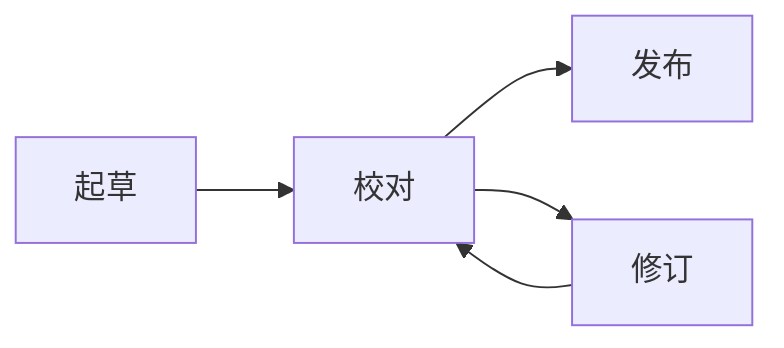

# 星图发布手记

从一行 Markdown，到一份可以交付的文档。

> 让想法成形，也让细节留在手边。

## 01 / 起草

从一页干净的文档开始。把散落的想法写成段落，再理出一个清楚的顺序。

- [x] 整理素材
- [x] 写下提纲
- [ ] 校对发布稿

## 02 / 拆解流程

先画出路径。把起草、校对与发布放在同一张图里。

## 03 / 定稿

发布之前，给整份文档留一次从头读到尾的机会。

| 阶段 | 产物 |
| --- | --- |
| 起草 | 结构与摘要 |
| 校对 | 最终文稿 |
| 发布 | 项目主页 |
